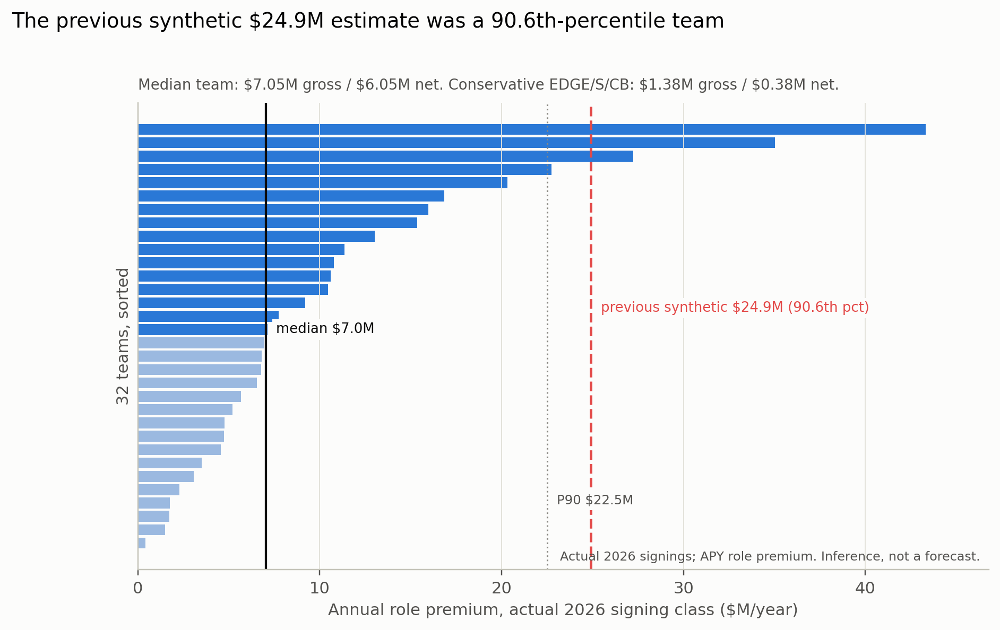

# The NFL free-agent market carries about $7M a year of uncut role premium

**Status:** included in the v2 Kaggle revision, with host-confirmed salary data
(discussion 751037);
the original judged text remains at `c652424`. The report was built after the
original judged entry. Date-stamped **2026-10-20**.

**Discussion:** [Kaggle thread on whether to include this finding in the BDB submission](https://www.kaggle.com/competitions/nfl-big-data-bowl-2027/discussion/751037).

Role is prior-season snap share in this model. A median team's 2026 free-agent
class carries about **$7.0M a year** of uncut modeled role premium — pay that
tracks role beyond measured performance. At the base **0.40** capture
assumption, the modeled annual capture is about **$2.8M gross / $1.8M net**
after a **$1M** implementation cost. The 32-team distribution runs from $1.81M
at P10 to $22.51M at P90.

*Role premium* means the raw minus role-controlled performance coefficient. It
is a conditional association, not an unearned-pay verdict.



## The finding

| Measure | Value | Note |
|---|---:|---|
| **Median team, uncut annual role premium** | **$7.05M** | actual 2026 signings |
| **Capture at 0.40, gross** | **$2.82M** | uncut premium × 0.40 |
| **Capture at 0.40, net after $1M** | **$1.82M** | median team |
| Team distribution (P10 / P50 / P90) | $1.81M / $7.05M / $22.51M | uncut premium, 32 teams |
| Mean team, uncut annual role premium | $10.73M | distribution is skewed |
| Conservative: only EDGE/S/CB | $1.38M uncut / −$0.45M net at 0.40 capture | cap-ledger gap CI > 0 |
| Low: only EDGE/S/CB | $1.38M uncut / −$0.29M net at 0.15 capture | near zero or negative |

The 2026 free-agent APY role premium is **+0.179 log points** (95% CI 0.022 to
0.336, n=306), close to the 2025 cap-ledger gap of **0.185** (0.094 to 0.276,
n=909). The 2025 active APY cross-check is **+0.105** (−0.005 to 0.214) and the
2024 sample is **+0.029** (−0.169 to 0.227); the premium is not stable across
every cut. The draft-matched 2026 gap survives at **+0.151** (0.016 to 0.286).
The free-agent premium itself is not detectable: team-changers do not have a
larger role premium than re-signings.

Adding contract length and guarantee share as commitment controls reduces the
2026 gap to **+0.049** (−0.093 to 0.191, n=253). The premium is not robust to
contract-structure controls. That is consistent with the premium being paid
through guarantees and years, not a clean forward-role test; there is no
forward role for the 2026 class.

Guarantees track role strongly: a one-unit higher prior-season snap share is
associated with **8.3 points** higher guarantee share (5.25 to 11.35), and the
guarantee share rises from 0.46 in the bottom snap-share quintile to 0.60 in the
top. The role premium is concentrated: the top 10% of contracts account for
**51%** of the positive premium.

The market portfolio now uses the bottom-up free-agency estimate. The uncut
total is **$11.03M base / $5.37M conservative / $0.18M low**; the
haircut-adjusted capture total is **$6.80M base / $4.54M conservative /
−$0.99M low**. The free-agency leg is **$1.82M net at the 0.40 capture
assumption**; the conservative EDGE/S/CB leg is **−$0.45M net** because the
capture does not cover the implementation cost.

## Who bears the cost

The dollar is a transfer from players to clubs, not a social saving. The
incumbent player and agent whose price is repriced bear the cost. The model is
symmetric: an agent can use the same coefficient to argue that role is
underpriced. The work does not claim any player is overpaid; it identifies
contracts where pay tracks role beyond the measured performance residual. The
transition rent is self-limiting: if every team adopts the principle, the market
reprices and the surplus flows to players.

## Read in this order

1. [`writeups/00_thesis.md`](writeups/00_thesis.md) — the question and the
   evidence tiers.
2. [`writeups/01_market.md`](writeups/01_market.md) — who signs, terms,
   guarantees, age, team changes.
3. [`writeups/02_pricing.md`](writeups/02_pricing.md) — APY, cap, guarantees,
   length, and the free-agent premium.
4. [`writeups/03_surplus.md`](writeups/03_surplus.md) — player/team residuals
   and concentration.
5. [`writeups/04_valuation.md`](writeups/04_valuation.md) — bottom-up valuation,
   the team distribution, and the valuation scenarios.
6. [`writeups/05_historical.md`](writeups/05_historical.md) — why the historical
   contract file is context, not a census.
7. [`writeups/06_adoption.md`](writeups/06_adoption.md) — the cap-manager
   playbook.
8. [`writeups/07_messaging.md`](writeups/07_messaging.md) — message house and
   prohibitions.

## Reproduce

```bash
python scripts/31_free_agency_events.py
python scripts/32_free_agency_market.py
python scripts/33_free_agency_pricing.py
python scripts/34_free_agency_surplus.py
python scripts/35_free_agency_valuation.py
python scripts/36_free_agency_history.py
python scripts/37_free_agency_figures.py
```

Outputs are written to `implications/free_agency/outputs/` (gitignored). The
frozen protocol is [`PROTOCOL.md`](PROTOCOL.md).

## Data and limits

- 2026 free-agent class: 1,086 contract rows / 1,043 players; 389 team changes,
  307 re-signs, 297 rookie deals, 529 one-year deals; 307 with a 2025
  performance row; 306 with a usable APY and `perf_z`; 301 with a non-missing
  `snap_share` in the role model.
- 2025 active APY contracts: 957 rows, 461 with `perf_z`.
- 2025 OTC cap ledger: 909 players with `perf_z`.
- Historical contracts: 30,769 rows, 1983–2022; not a census, no performance
  link, age coverage 62%.
- No transaction feed, signing dates, franchise-tag field, agent data, injury
  data, or compensatory picks. Free-agent status is inferred from prior team;
  APY, cap hit, and cash are different measures; the estimates are
  cross-sectional associations, not causal effects.
- The judged entry and the transfer extension are unchanged. The market
  portfolio's free-agency section is intentionally updated to this report.
