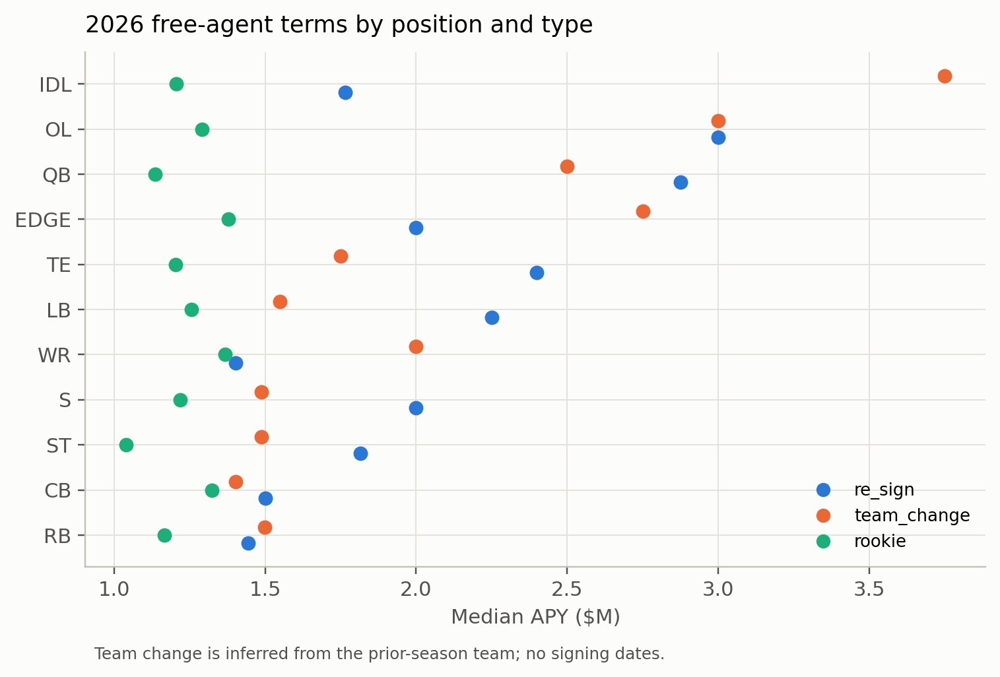
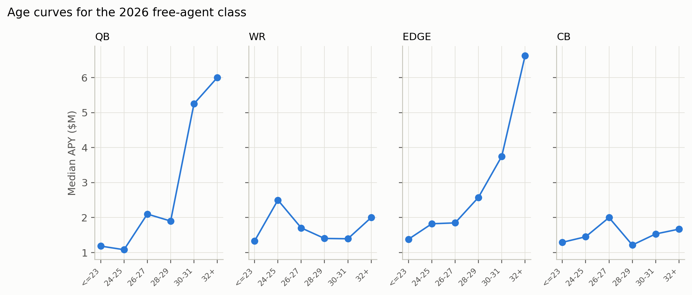

# The 2026 free-agent market

## Composition

The 2026 signing class in the current-contract snapshot has **1,086 contract
rows / 1,043 players**:

| Type | Count | Share |
|---|---:|---:|
| Team change (inferred) | 389 | 35.8% |
| Re-sign / extension | 307 | 28.3% |
| Rookie deal | 297 | 27.3% |
| One-year deal | 529 | 48.7% |

The median APY is **$1.50M** and the median guarantee share is **0.427**. The
class is dominated by short, low-to-mid APY deals; the top of the market is a
small share of the rows.

**Type is inferred.** There is no transaction feed or signing date. A team
change is the contract team differing from the player's 2025 team; a re-sign is
the same team and not a rookie deal (`start == rookie_season`). Extensions
before expiry cannot be separated from re-signs, and franchise tags cannot be
identified.

## Where the money goes

Total 2026 signing APY by position:

| Position | Contracts | Total APY ($M) | Share |
|---|---:|---:|---:|
| OL | 178 | 862.5 | 17.1% |
| IDL | 111 | 715.1 | 14.2% |
| WR | 119 | 616.1 | 12.2% |
| EDGE | 86 | 509.4 | 10.1% |
| LB | 110 | 456.2 | 9.0% |
| CB | 111 | 437.5 | 8.7% |
| QB | 50 | 403.0 | 8.0% |
| TE | 89 | 314.9 | 6.2% |
| RB | 80 | 305.6 | 6.1% |
| S | 93 | 301.5 | 6.0% |
| ST | 59 | 124.3 | 2.5% |

OL, IDL, and WR take the largest shares of free-agent APY. The OL share is
large even though OL has no individual performance measure in the cap ledger;
that is why the pricing leg excludes it.

## Team change vs re-sign

| Position | Re-sign median APY | Team-change median APY | Re-sign age | Team-change age |
|---|---:|---:|---:|---:|
| IDL | 1.77 | 3.75 | 28 | 29 |
| EDGE | 2.00 | 2.75 | 27 | 28 |
| WR | 1.40 | 2.00 | 26 | 28 |
| CB | 1.50 | 1.40 | 26 | 27 |
| S | 2.00 | 1.49 | 27 | 28 |
| LB | 2.25 | 1.55 | 27 | 27 |
| QB | 2.88 | 2.50 | 29 | 30 |
| TE | 2.40 | 1.75 | 27 | 28 |

The raw medians do not show a uniform free-agent premium: IDL, EDGE, and WR
team-changers get more; CB, S, LB, QB, and TE team-changers get less. After
controls, the team-change coefficient is **+0.499** (95% CI −0.164 to 1.162),
not distinguishable from zero. The free-agent premium is a market story, not a
measured uniform fact.

## Guarantees track role

The guarantee share is not only a performance payment. In the 2026 class:

- A one-SD higher `perf_z` is associated with **+0.045** guarantee share
  (0.015 to 0.076).
- A one-unit higher prior-season snap share is associated with **+8.30**
  guarantee share (5.25 to 11.35). Because snap share is measured 0–1 with a
  small SD, the practical contrast is the quintile view: mean guarantee share
  rises from **0.46** in the bottom snap-share quintile to **0.60** in the top.
- Each additional contract year is associated with **−0.087** guarantee share
  (−0.124 to −0.049).

Role is priced in guarantees even more clearly than in APY. That is the
contract-structure version of the allocation gap.

## Age and length

Team-changing free agents are older than re-signs in most positions (28–30 vs
26–29). One-year deals are 48.7% of the class; the median contract length is
one year for every position in the table. Long-term deals are concentrated at
the top of the market.

## Renewal wave

Existing contracts ending in the first-mover window:

| Contract end | Contracts | Sum of APY ($M) |
|---|---:|---:|
| 2026 | 749 | 2,033 |
| 2027 | 407 | 2,282 |
| 2028 | 433 | 2,833 |

The sums are total APY across all teams, not a one-team portfolio. They show the
size of the renewal population; the bottom-up valuation uses the actual 2026
signings, not these totals.

## Trade and draft context

nflverse trades (4,975 rows, 2002–2026) and draft picks (12,927 rows, 1980–2026)
show the most trade rows in OL, WR, LB, and S. This is market context, not a
causal price: trade terms are not a clean APY, and the draft-pick value field is
PFR's approximate value.

## Reading

The 2026 market is a short-deal market with a small high-end tail. Team changes
are a third of the class but do not earn a uniform premium after controls.
Guarantees are strongly role-linked, which is where the pricing correction has
its clearest contract-structure signature.
