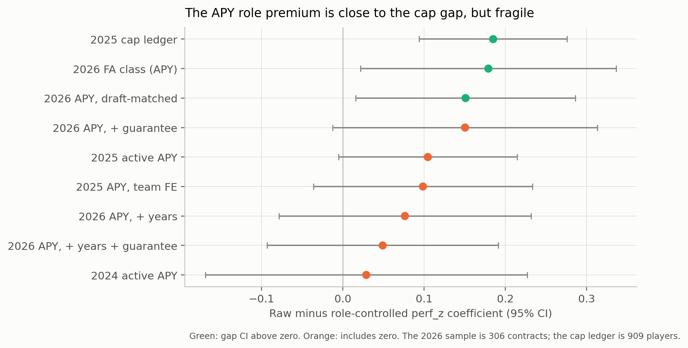
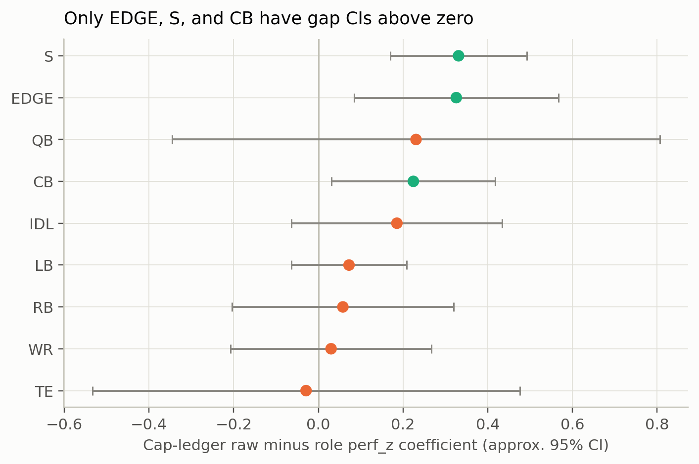
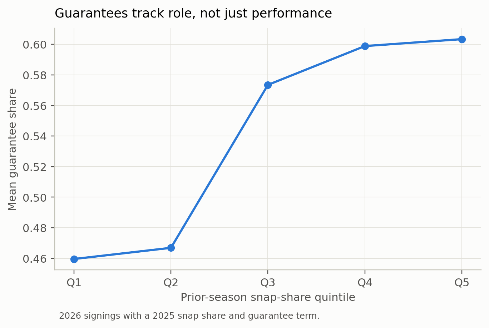

# What the market pays for performance and role

All models are cross-sectional associations with team-clustered SE. APY is the
primary pay measure; cap hit and current-year cash are robustness. No causal
claim.

## The role premium

The primary model is:

```
log(apy) ~ perf_z + age_at_signing + age² + years_exp + team_change
           + C(position)          # raw
           + snap_share           # role-controlled
```

The role premium is the raw `perf_z` coefficient minus the role-controlled one.

| Sample | Raw | Role | Gap (95% CI) | n |
|---|---:|---:|---|---:|
| **2026 FA class (APY)** | 0.497 | 0.317 | **+0.179 (0.022, 0.336)** | 306 |
| 2025 active APY | 0.318 | 0.214 | +0.105 (−0.005, 0.214) | 461 |
| 2024 active APY | 0.388 | 0.359 | +0.029 (−0.169, 0.227) | 132 |
| **2025 cap ledger** | 0.328 | 0.143 | **+0.185 (0.094, 0.276)** | 909 |
| 2026 APY, draft-matched | 0.399 | 0.248 | **+0.151 (0.016, 0.286)** | 306 |
| 2026 APY, + years | 0.238 | 0.162 | +0.076 (−0.079, 0.232) | 306 |
| 2026 APY, + guarantee share | 0.496 | 0.346 | +0.150 (−0.012, 0.313) | 253 |
| 2026 APY, + years + guarantee share | 0.238 | 0.189 | +0.049 (−0.093, 0.191) | 253 |
| 2025 APY, team FE | 0.315 | 0.216 | +0.099 (−0.036, 0.234) | 461 |

The 2026 APY gap is close to the 2025 cap-ledger gap: **0.179 vs 0.185**. That
is the central reconciliation between the contract-term evidence and the
existing cap model. Adding contract length and guarantee share as commitment
controls reduces the gap: years alone +0.076, guarantee share alone +0.150, both
+0.049. These are post-treatment contract-term controls, not a forward-role
measure; the 2026 class has no next-season role. The premium is not robust to
contract-structure controls.

 The 2025 active APY cross-check is smaller and its CI
crosses zero; the 2024 sample is null. The premium is not a stable fact in every
cross-section.

The draft-matched 2026 gap survives at **0.151** (0.016 to 0.286): draft capital
absorbs part of the coefficient, but not all of it. The team-FE 2025 gap is
0.099 and its CI crosses zero.

## By position (cap ledger)

| Position | Raw | Role | Gap (approx. 95% CI) | n | Status |
|---|---:|---:|---|---:|---|
| EDGE | 0.633 | 0.308 | **+0.326 (0.084, 0.567)** | 89 | primary |
| S | 0.261 | −0.070 | **+0.331 (0.170, 0.492)** | 128 | primary |
| CB | 0.321 | 0.097 | **+0.224 (0.031, 0.418)** | 122 | primary |
| IDL | 0.437 | 0.252 | +0.185 (−0.064, 0.434) | 105 | primary; CI includes 0 |
| QB | 0.637 | 0.406 | +0.231 (−0.345, 0.806) | 42 | exploratory |
| LB | 0.424 | 0.352 | +0.072 (−0.064, 0.208) | 205 | primary; CI includes 0 |
| RB | −0.019 | −0.077 | +0.058 (−0.203, 0.319) | 66 | exploratory |
| WR | 0.129 | 0.099 | +0.030 (−0.207, 0.267) | 106 | primary; CI includes 0 |
| TE | 0.036 | 0.065 | −0.029 | 46 | exploratory; no correction |

Only **EDGE, S, and CB** have role-premium CIs above zero. The per-position APY
cells are exploratory (n<60 for every position), so the position-level claim
leans on the cap-ledger sample. The 2026 APY point estimates are directionally
similar — CB 0.284, S 0.395, EDGE 0.170, IDL 0.143 — but the cells are thin.



## Guarantees and length

| Outcome | `perf_z` | `snap_share` | `team_change` | n |
|---|---:|---:|---:|---:|
| Guarantee share | +0.045 (0.015, 0.076) | +8.30 (5.25, 11.35) | −0.014 (−0.085, 0.056) | 250 |
| Contract years | +0.254 (0.114, 0.395) | +32.75 (13.33, 52.18) | −0.033 (−0.263, 0.197) | 250 |

The role premium is not only headline APY. Role predicts guarantees and
length: a higher prior-season snap share means more guaranteed money and more
years. The practical contrast is the guarantee-share quintile: **0.46** at the
bottom of the snap-share distribution versus **0.60** at the top.



## Is the premium larger for free agents?

The 2026 interactions:

| Term | Coefficient (95% CI) | p |
|---|---|---:|
| `team_change` | +0.499 (−0.164, 1.162) | 0.141 |
| `perf_z × team_change` | +0.070 (−0.175, 0.315) | 0.577 |
| `snap_share × team_change` | −33.7 (−64.8, −2.6) | 0.034 |

The free-agent premium is not detectable: the `team_change` coefficient is
positive but its CI crosses zero, and the `perf_z` interaction is null. The
`snap_share` interaction is negative, but it is large and collinear with the
other role terms; treat it as descriptive, not a clean "free agents are paid
less for role" result. The 2025 interactions are null.

## Robustness

- **APY vs cap hit.** The cap-ledger gap 0.185 and the 2026 APY gap 0.179 are
  close; the 2025 APY cross-check 0.105 is smaller. APY is the primary measure
  because it is the contract price; cap hit embeds proration and restructures.
- **Prior vs concurrent performance.** The 2026 class uses 2025 performance
  before signing; the 2025 active APY sample uses concurrent 2025 performance.
  The difference (0.179 vs 0.105) may be sample or timing.
- **Draft-matched.** The 2026 gap survives at 0.151; the existing cap-ledger
  draft-matched model shrank to 0.064 (role) and 0.040 (role+draft) on 153
  players. The APY sample is larger and the gap is more robust, but draft
  capital still absorbs part of it.
- **2024.** The 2024 APY gap is 0.029 with a wide CI; it is a thin sensitivity,
  not evidence against the 2026 result.
- **Team FE.** The 2025 APY team-FE gap 0.099 crosses zero; team identity
  absorbs some of the premium.
- **Age functional form.** Quadratic primary; binned/spline as a sensitivity
  (not shown in the headline table).

## Caveats

- **`snap_share` is endogenous.** Role is itself an allocation outcome; the
  role-controlled coefficient removes the part of pay that travels through
  current/prior role, not an experimentally assigned role. The gap is a
  decomposition, not a causal effect of suppressing role.
- **Cross-construct performance.** The contract models use the salary layer's
  nflverse production composite, not the BDB NGS residual. The pricing leg is
  internally consistent with the cap model but not the same construct as the
  transfer measurement.
- **Selection.** Free agents and re-signers are different populations; the
  models condition on observed performance, role, age, and position, not on
  unobserved injuries, scheme fit, or agent strategy.
