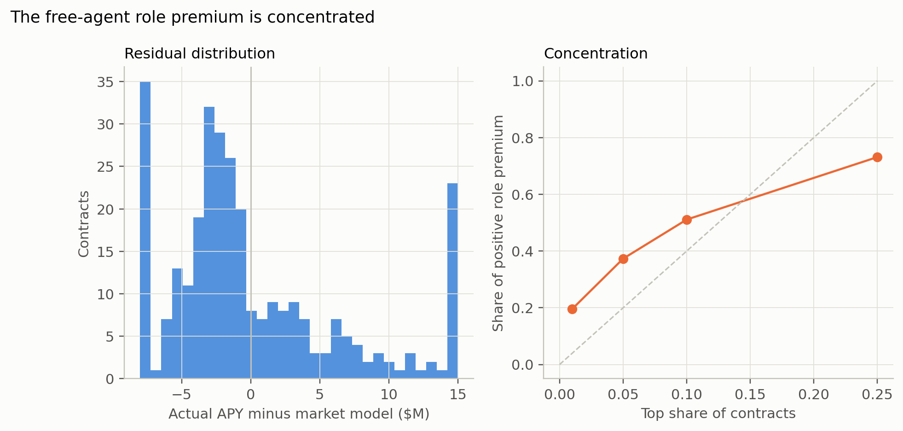

# Surplus: who is above or below the market model?

## Method

For the 2026 signing class (n=301 with APY, performance, role, age, and team):

- Fit the raw APY model and the role-controlled model.
- Predict APY with a lognormal retransformation and Duan smearing.
- Raw residual = actual APY − raw-model prediction.
- Role-controlled residual = actual APY − counterfactual role-controlled
  prediction.
- Role premium = raw prediction × (1 − exp(−gap × `perf_z`)).

A positive raw residual means the contract is above the market model. It is
**not** proof of a mistake: the model omits injuries, scheme, guarantees,
agent strategy, and unobserved quality.

## Distribution

- Mean raw residual: **−$0.071M** (near zero by construction after smearing).
- Median raw residual: **−$1.71M**; the distribution is right-skewed by a small
  high-APY tail.
- Mean role premium: **$0.857M** per contract.

The median contract is below the model's conditional mean; the top tail is
above it. Report the distribution, not a single average.

## By position

Mean role premium per contract:

| Position | n | Mean role premium ($M) |
|---|---:|---:|
| IDL | 47 | 2.074 |
| WR | 33 | 1.667 |
| TE | 19 | 1.335 |
| QB | 15 | 0.638 |
| EDGE | 27 | 0.548 |
| LB | 50 | 0.531 |
| RB | 23 | 0.283 |
| CB | 40 | 0.278 |
| S | 47 | 0.249 |

The high-APY positions (IDL, WR) have the largest dollar role premiums because
the premium is proportional to predicted APY. The per-position cells are thin
(QB 15, TE 19, RB 23); read them descriptively.

## Concentration

| Top share of contracts | Share of positive role premium |
|---:|---:|
| 1% | 19.6% |
| 5% | 37.3% |
| 10% | 51.1% |
| 25% | 73.1% |

Half of the positive role premium sits in **16 contracts** (the top 10%). The
pricing correction is not a broad across-the-board repricing; it is a
concentrated re-pricing of a small set of high-APY, high-performance,
high-role contracts.

## Team view

Team totals of the role premium and the raw residual are different measures:

- The **role premium** is the counterfactual saving if the team priced the same
  contracts on the role-controlled coefficient. It depends on the team's
  contracts, APY, and performance.
- The **raw residual** is actual APY minus the market model. It is a
  model-deviation measure, not a saving.

The top team role premiums are TEN ($38.99M annual), LAR ($33.96M), GB
($25.45M), DAL ($20.81M), CAR ($16.68M), and PIT ($14.83M). The bottom are CIN
(−$4.69M), LV (−$2.46M), CLE (−$0.90M), and BUF (−$0.25M). These are
descriptive; a team with a high role premium may also have a negative raw
residual (TEN: +$38.99M role premium, −$51.07M raw residual). Do not read the
role premium as "overpay."

There is no clean relationship between team role premium and 2025 wins in this
one-season cross-section. The report does not claim one.

## Guarantees and length

The highest role-premium contracts are not simply the longest or most
guaranteed. The guarantee model (Section 02) shows role predicts guarantee
share; the surplus distribution shows the premium concentrated in high-APY
contracts. The two facts are consistent: role is priced in guarantees and APY,
but the dollar premium is largest where APY is largest.

## Reading

The free-agent role premium is **concentrated, skewed, and team-specific**. A
median-team estimate is the right one-team summary; a league total or a top-team
total would overstate the typical case. The top-decile concentration is why the
bottom-up valuation uses the median team and reports the distribution.
