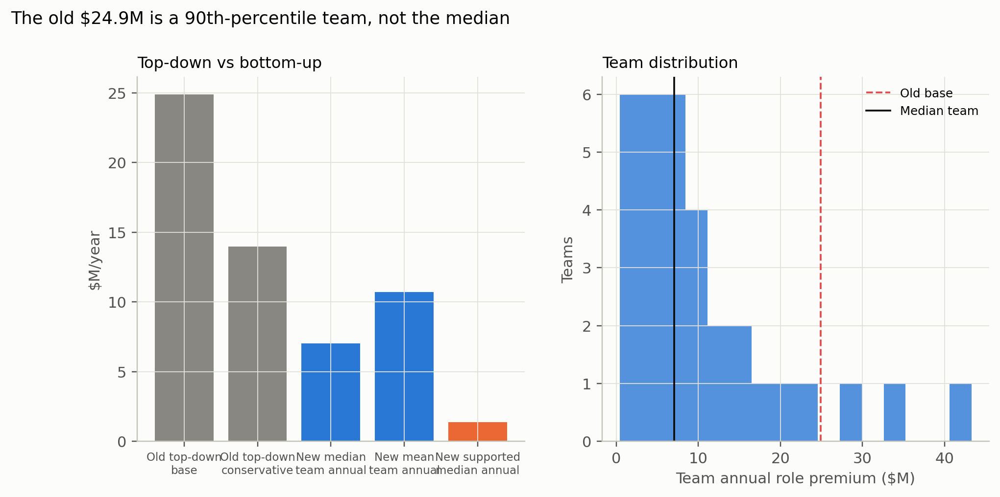

# Bottom-up valuation: the actual 2026 signing class

## The estimate

The one-team estimate is the **median team's annual role premium** in the 2026
signing class. The uncut premium is the market attribution. The capture is the
part a team can realize at the scenario haircut, after implementation cost. The
league total is context; the mean is reported because the distribution is
skewed.

| Scenario | Positions | Uncut annual | Haircut | Capture gross | Cost | Capture net | Capture EV | Contract-total median |
|---|---|---:|---:|---:|---:|---:|---:|---:|
| Low | EDGE/S/CB | 1.38 | 0.15 | 0.21 | 0.50 | **−0.29** | −0.06 | 0.42 |
| **Base** | all | **7.05** | **0.40** | **2.82** | **1.00** | **1.82** | **0.73** | **5.80** |
| Conservative | EDGE/S/CB | 1.38 | 0.40 | 0.55 | 1.00 | **−0.45** | −0.18 | 1.13 |
| High | all | 7.05 | 0.60 | 4.23 | 2.00 | **2.23** | 1.34 | 8.70 |

The **base** is $7.05M uncut / $2.82M gross / $1.82M net at the 0.40 capture
assumption, or $0.73M expected at 40% adoption. The **conservative** view keeps
only the positions whose cap-ledger role-premium CI is above zero (EDGE, S, CB)
and is $1.38M uncut / $0.55M gross / **−$0.45M net**: the capture does not cover
the $1M implementation cost. The **low** case is $1.38M uncut / $0.21M gross /
**−$0.29M net**. The conservative and low capture cases are negative; the uncut
premium stays positive.

The base covers the median team's 9 contracts with observed APY, performance,
role, age, and team. The contract-total median ($5.80M) multiplies the APY
premium by contract years and the 0.40 haircut; it is multi-year and is not
comparable to the annual capture.

## Team distribution

| Percentile | Annual role premium ($M) |
|---|---:|
| P10 | 1.81 |
| P25 | 4.68 |
| P50 | 7.05 |
| P75 | 13.62 |
| P90 | 22.51 |
| Mean | 10.73 |
| Min | 0.40 |
| Max | 43.31 |

The distribution is right-skewed. The median team is $7.05M; the mean is
$10.73M; the top decile starts at $22.5M. The **old top-down $24.91M sits at the
90.6th percentile**. The old conservative $13.97M is near the 75th percentile
($13.62M).

## The bridge from the top-down estimate

| Measure | Value ($M) | Note |
|---|---:|---|
| Old top-down base | 24.91 | synthetic one-team portfolio |
| Old top-down conservative | 13.97 | CI-supported positions |
| Old top-down low | 5.33 | low assumptions |
| New median team annual | 7.05 | actual 2026 signings; uncut |
| New median team capture net | 1.82 | uncut × 0.40 − $1M |
| New mean team annual | 10.73 | distribution mean; uncut |
| New median team contract total | 5.80 | APY premium × years × 0.40 |
| New league annual | 343.37 | all 32 teams; context only |
| Old base percentile | 90.6% | share of teams below $24.9M |
| New supported median annual | 1.38 | EDGE/S/CB only; uncut |

The difference is not one error. It is the combination of:

1. **Actual contract population vs synthetic portfolio.** The top-down model
   scaled a $50M DL portfolio by team positional spending. The median team's
   actual 2026 signing class has 9 contracts with observed performance; the
   synthetic portfolio was much larger. This is the largest driver.
2. **All positions vs CI-supported positions.** The base uses every position's
   pooled role premium; the conservative keeps only EDGE/S/CB, whose cap-ledger
   gap CIs are above zero. $7.05M → $1.38M.
3. **APY vs cap hit.** The 2026 APY gap 0.179 is close to the 2025 cap gap
   0.185; this is not the main driver.
4. **Prior vs concurrent performance.** The 2026 event sample gap 0.179 is
   larger than the 2025 active APY cross-check 0.105; the event sample is the
   appropriate one for a signing decision.
5. **Draft controls.** The draft-matched gap 0.151 is 16% smaller than 0.179;
   a modest haircut.
6. **Haircut.** 0.40 is a judgment; the low (0.15) and high (0.60) cases show
   the range.

The honest conclusion: **the free-agency lever is real, but the old $24.9M was
an upper-tail team's synthetic portfolio, not the median team's actual
renewal wave.** The median team's uncut premium is $7.05M; the capture at 0.40
is $1.82M net. The CI-supported subset is $1.38M uncut and **−$0.45M net**: at
the base haircut it does not cover the implementation cost.

## Monte Carlo

20,000 draws, seed 20261020; team resampling, haircut triangular
(0.15, 0.40, 0.60), cost (0.5, 1.0, 2.0), adoption (0.2, 0.4, 0.6).

| Population | Net P10 | Net P50 | Net P90 | EV P50 | P(net > 0) |
|---|---:|---:|---:|---:|---:|
| All positions, uncut | 3.35 | 5.96 | 9.23 | 2.32 | 1.00 |
| All positions, capture at 0.40 | 0.58 | 1.69 | 3.04 | 0.65 | 0.98 |
| EDGE/S/CB only, uncut | −0.69 | 0.09 | 0.87 | 0.03 | 0.56 |
| EDGE/S/CB, capture at 0.40 | −1.16 | −0.65 | −0.19 | −0.25 | 0.03 |

The all-position uncut case is positive across the draws; the CI-supported
capture is negative in 97% of draws. That is why the report leads with both the
uncut premium and the capture.

## Portfolio update

The market portfolio now uses this report's bottom-up summary:

- Free agency: **$6.05M uncut / $1.82M capture base; $0.38M uncut / −$0.45M
  capture conservative; $0.88M uncut / −$0.29M capture low**.
- Portfolio uncut total: **$11.03M base / $5.37M conservative / $0.18M low**.
  Portfolio capture total: **$6.80M base / $4.54M conservative / −$0.99M low**.
- The free-agency market is still the largest single market ($6.05M uncut /
  $1.82M capture versus $2.45M for the DL anchor's selection + role), but no
  longer an order of magnitude larger.
- The old top-down components remain in `contract_components.csv` as a
  `legacy_top_down` cross-check; they are not added to the portfolio.

## What would change the estimate

- **A larger renewal population.** A team with more high-APY contracts with
  observed performance moves toward the top decile.
- **More CI-supported positions.** If IDL, LB, or WR gaps become CI-supported,
  the conservative view rises toward the base.
- **Guarantees and structure.** If the role premium is paid in guarantees
  rather than APY, the headline APY saving overstates the cash saving. The
  guarantee model shows role predicts guarantees; the report does not net them
  out in the base.
- **Adoption and negotiation.** The EV applies a flat adoption probability; a
  real negotiation response would reduce it.
- **A different haircut.** 0.40 is a judgment; 0.15 gives a near-zero low case,
  0.60 a high case around $8.6M net.
