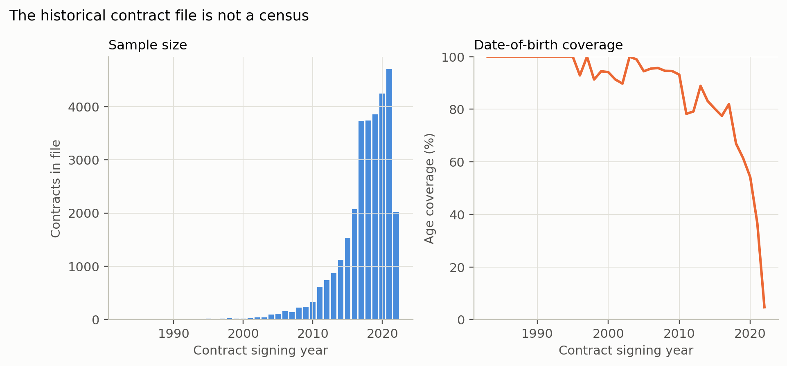

# Historical contracts: context, not a census

The historical contract file (`data/external/historical_contracts.csv.gz`) has
**30,769 rows, 1983–2022**. It is tempting to read it as a long-run positional
value series. It is not one.

## What the file contains

- Player, position, team, `year_signed`, `years`, `value`, `apy`, `guaranteed`,
  `apy_cap_pct`, inflators, OTC id, date of birth, and draft fields.
- No performance measure and no role measure. It cannot test the role premium.
- Date of birth is present for **62.1%** of rows; age-at-signing series drop the
  rest.

## Why the trend is not comparable

The file is not a complete contract census, and its composition changes
dramatically by year:

| Year | Contracts in file | Median APY ($M) |
|---|---:|---:|
| 1994 | 9 | 0.46 |
| 2000 | 17 | 4.53 |
| 2010 | 322 | 0.88 |
| 2020 | 4,239 | 0.61 |
| 2022 | 2,020 | 0.90 |

The 1990s rows are a small, selected set of contracts; the 2020 rows are
dominated by minimum and short deals. The median `apy_cap_pct` therefore moves
from 0.013 in 1994 to 0.003 in 2020, which is a coverage composition effect,
not a positional-value repricing. A line chart of the median would be
misleading, so this report does not publish one.

The historical figure in this folder is therefore a **coverage** chart:
contracts per year and date-of-birth coverage. It shows the sample-size problem
directly.

## What the file can support

- **Within-year** age-at-signing comparisons for the years with good DOB
  coverage.
- **Within-year** guarantee-share and contract-length descriptions.
- **Market context** for the 2026 findings, with the coverage caveat stated.

It cannot support:

- A 1983–2022 positional value trend.
- A historical role-premium test.
- A claim that EDGE/S/CB value "rose" or "fell" over time.
- A comparison of APY cap share across eras.

## Reading

The historical file is useful as a reminder that contract data are
selection-laden: what is in the file changes by year. The dedicated report's
primary evidence is the 2026 signing class, where the contract population and
the performance/role joins are known. Historical context is reported, not
overread.
