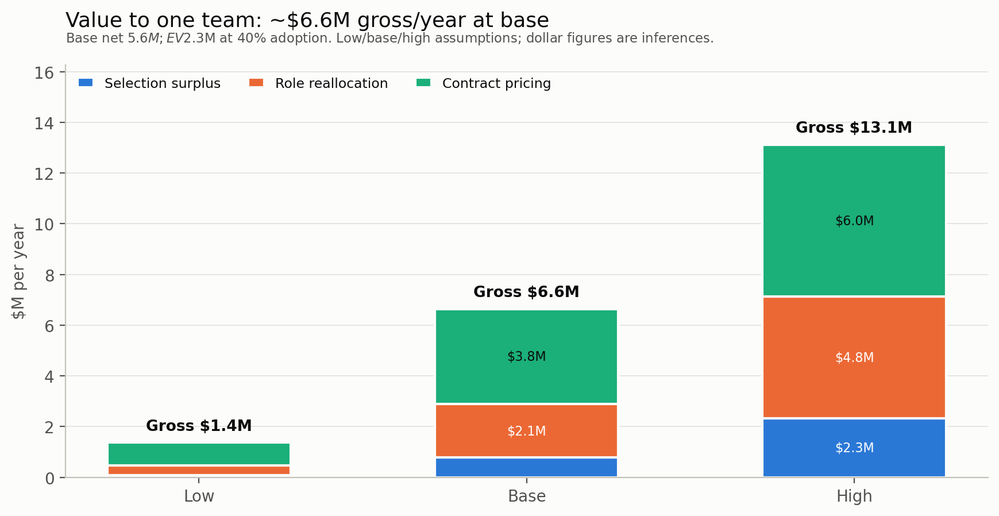
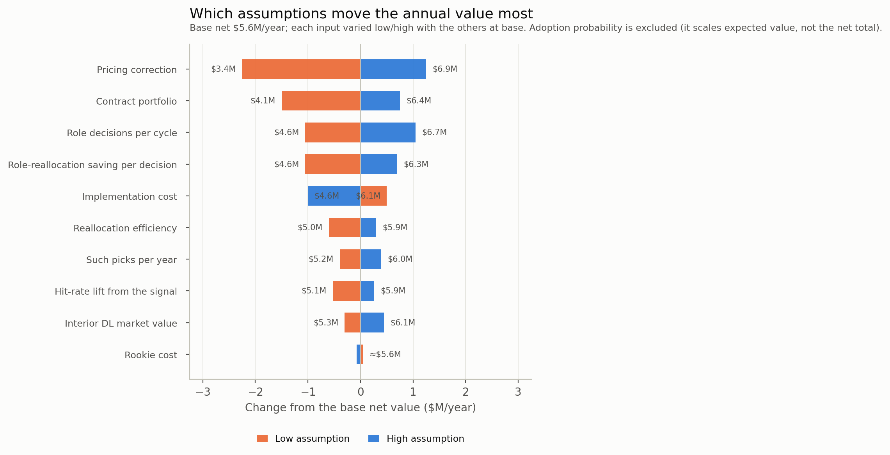

# A transparent dollar model for the allocation lever

**Status:** extension to the 2027 NFL Big Data Bowl entry, not part of it. GitHub only; not published on Kaggle. Date-stamped 2026-10-19. **Every dollar figure here is an inference, not a measurement.** The measured coefficients are cited with their sources; the assumptions are explicit and ranged.

## The answer

For one team that adopts a low-political-cost chunk of the principle, the base case is:

- **$6.6M gross per year**
- **$5.6M net per year** after a $1.0M implementation cost
- **$2.3M expected per year** at 40% adoption
- **2.0% of a $280M cap**

The low case is **$0.9M net**; the high case is **$11.1M net**. The order of magnitude is **several million dollars per year**, reaching **$10M+ at the high end**. The number is not a forecast; it is a structured way to see which assumptions matter.

## Assumptions

All dollar inputs are in $M per year unless noted.

| Parameter | Low | Base | High |
|---|---:|---:|---:|
| Team cap (context only) | 260 | 280 | 300 |
| Interior DL market value | 8 | 12 | 18 |
| Rookie cost | 0.8 | 1.5 | 2.5 |
| Hit-rate lift from the signal | 5% | 15% | 20% |
| Control window | 4 years | 4 years | 4 years |
| Such picks per year | 0.25 | 0.50 | 0.75 |
| Role-reallocation saving per decision | 3.0 | 6.0 | 8.0 |
| Role decisions per cycle | 0.25 | 0.50 | 0.75 |
| Reallocation efficiency | 50% | 70% | 80% |
| Contract portfolio | 30 | 50 | 60 |
| Pricing correction | 3.0% | 7.5% | 10.0% |
| Implementation cost | 0.5 | 1.0 | 2.0 |
| Adoption probability | 20% | 40% | 60% |

The measured inputs — the pressure signal, the cap coefficients, the role coefficients — are not assumptions. They are in `outputs/discovery/` and `outputs/salary/` and are reproduced by the committed pipeline. The table above is what the model adds.

## The three routes

**Selection surplus.** A late-round or undrafted interior lineman who becomes a starting-caliber producer on a rookie deal is worth the gap between his market value and his rookie cost. At base, a hit is worth **$42M over four years** (($12M − $1.5M) × 4 = $42M). A 15% hit-rate lift makes the expected value **$6.3M per pick over four years**. At 0.5 such picks per year, the steady-state annual flow is:

`0.15 × ($12M − $1.5M) × 0.5 = $0.79M/year`

The years cancel in the annual flow; they matter for the per-pick total, not the steady-state value. The selection route is deliberately small. The signal's job is to identify a cheap contributor, not to carry the whole case.

**Role reallocation.** Replace the pass-rush snaps of a high-cap, low-burst veteran with a low-cost, high-burst interior lineman. At base, the saving is $6M per decision, one half-decision per cycle, and a 0.7 efficiency for converting cap space into production:

`$6M × 0.5 × 0.7 = $2.1M/year`

The efficiency haircut is the honest part: cap savings are not value unless the space is redeployed. The descriptive rent decomposition gives a larger upper bound: Q4 minus Q1 total rent is **−$20.5M**, with star rent −$14.2M and underperformer rent −$6.3M. The forward model is conservative relative to that.

**Contract pricing.** Price the next interior-DL contract on role-controlled performance (+0.143) rather than the raw coefficient (+0.328). The gap is 0.185 log points, or about 20.3%; on a $10M contract, roughly $2.0M is the role premium a correction could avoid. Across a $50M portfolio with a 7.5% correction:

`$50M × 7.5% = $3.75M/year`

The pricing correction is calibrated to the coefficient gap, not invented: the low case (3%) is a conservative haircut below the 7.5% base; the high case (10%) is a wider repricing.

## Scenarios

| Scenario | Selection | Role | Contract | Gross | Cost | Net | EV at adoption |
|---|---:|---:|---:|---:|---:|---:|---:|
| Low | 0.09 | 0.38 | 0.90 | 1.36 | 0.50 | **0.86** | 0.17 (20%) |
| Base | 0.79 | 2.10 | 3.75 | 6.64 | 1.00 | **5.64** | 2.26 (40%) |
| High | 2.33 | 4.80 | 6.00 | 13.12 | 2.00 | **11.12** | 6.68 (60%) |

All values in $M/year. The routes are not causally additive: if the same organisational change drives both the role and contract decisions, the low case is the conservative guide.

## Sensitivity

The annual net value is most sensitive to the inputs that govern the contract and role routes, not the Combine signal:

| Input | Net at low | Net at high | Swing |
|---|---:|---:|---:|
| Pricing correction | 3.39 | 6.89 | 3.50 |
| Contract portfolio | 4.14 | 6.39 | 2.25 |
| Role decisions per cycle | 4.59 | 6.69 | 2.10 |
| Role-reallocation saving | 4.59 | 6.34 | 1.75 |
| Implementation cost | 6.14 | 4.64 | 1.50 |
| Reallocation efficiency | 5.04 | 5.94 | 0.90 |
| Hit-rate lift / picks / market | — | — | 0.75–0.79 |

The Monte Carlo (20,000 draws, seed 20261019) treats the inputs as independent triangular distributions. Net value is **P10 $3.27M, P50 $4.64M, P90 $6.02M**; expected value is **P10 $1.14M, P50 $1.80M, P90 $2.62M**. The deterministic low/high is the wider stress range. Independence is a limitation: the role saving and the pricing correction are plausibly correlated through the same organisational adoption decision. The Monte Carlo also does not model the probability that the pressure signal itself fails; the cross-construct and team-fixed-effects caveats are outside it.

## What would make it zero

| Lever | Breakeven | Base | Interpretation |
|---|---:|---:|---|
| Hit-rate lift | 0 pp | 15 pp | The selection surplus disappears. |
| Role saving per decision | $0 | $6M | Guarantees and dead money block the reallocation. |
| Pricing correction | 0% | 7.5% | The market already prices role-controlled performance. |
| Implementation cost | $6.6M | $1.0M | Cost consumes the gross value. |
| Adoption probability | 0% | 40% | No one acts on the analysis. |
| Contract coefficient | 0 | +0.143 | The 95% CI includes 0.078, so the true correction may be small. |

Zero is a scenario, not a forecast.

## Caveats

- **The cap is context, not a formula driver.** The model uses $280M to express the result as a share of cap; the routes are dollar flows, not cap-space accounting.
- **The routes overlap.** The selection, role, and contract routes can be the same organisational decision seen three ways. The low case is the conservative guide.
- **The first-mover window is finite.** If every team adopts the principle, the market re-prices and the surplus flows to players. The value is a transition rent, plausibly 2–5 years, not a permanent edge.
- **The measured associations are not causal.** The pressure signal's team-fixed-effects estimate is +0.298 (p=0.089); the role performance coefficient is −0.011 with a CI that includes zero; the agent model is model-reproduced. The dollars inherit those limits.
