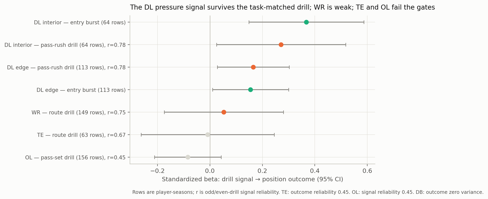

# L1 — task-matched drill translation

**Question.** Does a position-specific 10 Hz skill-drill signal predict that
position's performance outcome beyond the stopwatch and the generic movement
composite?

## Method

- Attempt-level kinematics from `src/features/combine_tracking.py` are
  standardized within `drill_name × position_group`, averaged to player × drill,
  then to player × family with equal drill weight.
- Primary signal per position is fixed in the protocol: WR/TE `route_burst`
  (first-step acceleration and time-to-1-yard across route drills); DB
  `transition_quick` (time-to-1-yard and path efficiency across back-pedal
  drills); OL `pass_set_quick` (time-to-1-yard and acceleration across pass-set
  drills); DL `pass_rush_burst` (speed and acceleration on `PASS_RUSH_DRILL`).
- Model: `outcome ~ signal_z + B_draft + C(season)`, player-clustered SE. WR,
  TE, OL, DB use the panel `perf_z`; DL uses `pressure_rate_z`, the entry's
  headline outcome. The entry's `burst_z` is the benchmark row.
- Gates: signal split-half ≥ 0.50, outcome split-half ≥ 0.50, ≥ 60 player-season
  rows.

## Results

| Area | Signal | Outcome | Rows / players | Beta (95% CI) | Signal r | Outcome r | Incremental R² | Status |
|---|---|---|---:|---|---:|---:|---:|---|
| WR | route drill | separation residual | 149 / 82 | +0.053 (−0.174, 0.280) | 0.747 | 0.675 | −0.012 | **weak** |
| TE | route drill | separation residual | 63 / 33 | −0.008 (−0.262, 0.245) | 0.671 | 0.449 | −0.240 | unidentifiable |
| OL | pass-set drill | pressure-allowed residual | 156 / 89 | −0.084 (−0.211, 0.043) | 0.448 | 0.553 | +0.007 | unidentifiable |
| DL interior | entry `burst_z` (benchmark) | pressure | 64 / 42 | **+0.368 (0.149, 0.587)** | — | 0.953 | +0.050 | benchmark |
| DL interior | pass-rush drill | pressure | 64 / 42 | **+0.271 (0.025, 0.517)** | 0.781 | 0.953 | −0.027 | borderline after Holm |
| DL edge | entry `burst_z` (benchmark) | pressure | 113 / 56 | **+0.155 (0.010, 0.300)** | — | 0.953 | −0.007 | benchmark |
| DL edge | pass-rush drill | pressure | 113 / 56 | **+0.166 (0.029, 0.303)** | 0.781 | 0.953 | +0.015 | borderline after Holm |
| DB | back-pedal drill | coverage residual | 161 / 90 | — | 0.092 | 0.121 | — | unidentifiable |

The DL positive control reproduces the entry's result: +0.368 (0.149, 0.587)
against +0.354 (0.143, 0.565). The pipeline is measuring the same thing.

The task-matched DL signal is positive in both subgroups, but it is only
marginally significant after the pre-registered Holm correction across the
primary family: interior +0.271 (unadjusted p=0.031, Holm p=0.061), edge +0.166
(unadjusted p=0.018, Holm p=0.054). Report both; the unadjusted status is
`supported`, the corrected result is borderline.

The incremental check is sobering. The entry benchmark adds **+0.050 R²** over
the stopwatch plus draft (95% CI −0.019 to 0.124), essentially the entry's
reported +0.049. The task-matched pass-rush signal adds **−0.027** for interior
and **+0.015** for edge, with CIs spanning zero. The positive coefficient is
conditional on draft; the out-of-sample increment over the incumbent is not
established. This is the same distinction the entry makes between a coefficient
and a validated tool.

Outside DL, the measurement link does not clear its gates. WR is the only
testable non-DL area, and its point estimate is +0.053 SD/SD with a CI spanning
zero; the rank correlation is 0.003. TE's outcome is too unreliable (0.449); OL's
signal is too unreliable (0.448); DB has no performance variance.

## Per-drill exploratory check

Every individual drill in each primary family was also estimated (BH FDR within
position). The strongest rows:

| Area | Drill | Rows | Beta (95% CI) | p | q |
|---|---|---:|---|---:|---:|
| TE | OVER_THE_SHOULDER_ADJUST | 29 | −0.218 (−0.395, −0.041) | 0.016 | 0.124 |
| DL edge | PASS_RUSH_DRILL | 113 | +0.166 (0.029, 0.303) | 0.018 | 0.031 |
| OL | PASS_PRO_MIRROR_DRILL | 70 | −0.229 (−0.429, −0.029) | 0.025 | 0.074 |
| DL interior | PASS_RUSH_DRILL | 64 | +0.271 (0.025, 0.517) | 0.031 | 0.031 |
| WR | CURL_ROUTE_RIGHT | 141 | +0.157 (−0.035, 0.349) | 0.109 | 0.724 |
| WR | POST_CORNER_ROUTE_LEFT | 126 | +0.139 (−0.032, 0.310) | 0.111 | 0.724 |

No non-DL drill produces a positive signal that survives FDR. The two
significant non-DL coefficients are negative, the opposite of the predicted
direction. The WR route-specific estimates are positive but indistinguishable
from zero.

## Reading

The task-matched drill idea is the right analogy, but the measurement does not
generalize across positions with this dataset. The DL result is a genuine
positive control; WR is a weak, directionally positive shadow; TE, OL, and DB
are unidentifiable for measurement reasons rather than evidence of no effect.

The result is consistent with the entry's position-specific finding: the 10 Hz
signal is not a universal talent score. It also sets up the next link: the
drill signals that are measurable are not the ones the draft prices.
