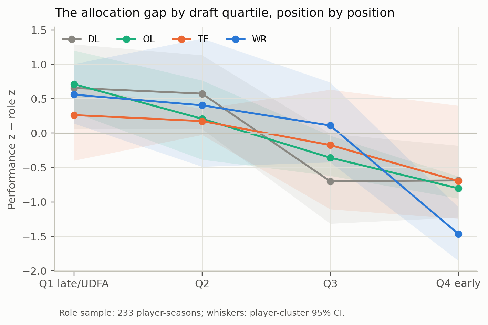

# L3 — the allocation gap by position

**Question.** Is measured performance unrewarded in next-season role while
current role and draft are rewarded, in each position group?

## Method

- Reuse the per-position role equations in
  `outputs/discovery/role_allocation_positions.csv`:
  `next_role ~ role_z + perf_z + B_draft`, player-clustered SE.
- Recompute the descriptive gap `perf_z − role_z` by within-position
  `B_draft` quartile. Positive means the player performs above his role.
- Player-cluster bootstrap CIs (5,000 draws). Tail = top performance quartile
  and bottom role quartile.
- DB is excluded: the performance residual has zero variance in the panel, so
  the gap is not interpretable.

## Role equations

| Position | Role coefficient | Performance coefficient (95% CI) | Draft coefficient | Rows |
|---|---:|---|---:|---:|
| DL | +0.593 | −0.090 (−0.252, 0.072) | +1.131 | 76 |
| WR | +0.639 | −0.018 (−0.232, 0.196) | +0.341 | 65 |
| OL | +0.491 | +0.190 (−0.057, 0.438) | +1.174 | 65 |
| TE | +0.712 | +0.034 (−0.260, 0.328) | +0.388 | 27 |
| DB | +0.335 | unidentifiable | +1.748 | 69 |

The DB row is from the discovery role panel (n=69); the transfer gap panel has
0 usable DB rows because the performance residual has no variance. TE is 27 in
the transfer gap panel after the merge; the discovery panel has 29 rows before
the merge.

Current role and draft are positive everywhere; performance is null everywhere.
This is the same allocation pattern as the pooled entry, position by position.
The one positive point estimate is OL (+0.190), and its CI includes zero.

## Gap by draft quartile

| Position | Q1 late/UDFA | Q2 | Q3 | Q4 early |
|---|---:|---:|---:|---:|
| WR | +0.559 | +0.404 | +0.111 | −1.464 |
| OL | +0.712 | +0.208 | −0.357 | −0.802 |
| DL | +0.656 | +0.574 | −0.700 | −0.688 |
| TE | +0.262 | +0.174 | −0.174 | −0.696 |

The gradient is monotonic in WR, OL, and DL. TE points the same way but is
noisy: 27 role rows, 4–5 players per quartile, and CIs that cross zero.

## Strict tail

| Position | Rows / players | Mean gap | 95% CI | Next role | Mean draft |
|---|---:|---:|---|---:|---:|
| WR | 5 / 4 | +2.748 | (2.077, 3.195) | −1.00 | 0.334 |
| OL | 6 / 6 | +2.474 | (1.883, 3.065) | −0.43 | 0.210 |
| DL | 7 / 6 | +2.241 | (2.005, 2.411) | −1.01 | 0.186 |

The strict tail is a review list, not a population. It is the same descriptive
object as the entry's 13-player-season tail: high measured performance, low
role, mostly later picks. The tail does not persist: next-season role is still
below the mean.

## Tier 2 directional check

The Tier 2 assumptions predict that the performance→role coefficient should be
flatter where outcome reliability is lower (risk aversion plus noisy
performance). With five positions this is a descriptive ordering, not a test.
It is not supported:

| Position | Outcome reliability | Performance→role |
|---|---:|---:|
| DL | 0.953 | −0.090 |
| WR | 0.675 | −0.018 |
| OL | 0.553 | +0.190 |
| TE | 0.449 | +0.034 |
| DB | 0.121 | unidentifiable |

The only positive estimate is OL, which sits in the middle of the reliability
range; the two highest-reliability positions are null or negative. Reliability
alone does not explain the wedge. That is a useful negative result: the Tier 2
story needs the status and risk weights, not just measurement noise.

## Reading

This is the most portable part of the argument. The performance→role null and
the draft gradient replicate in every position with enough reliable data. The
gap is mostly role, as in the entry; it is not evidence that late picks are
better players.

**Caveats.** Playing time is snaps per appearance, not depth-chart rank or
coaching intent. The performance residual is observational and position-specific.
The role sample is 233 player-seasons with a next season; the per-position cells
are 27–76 rows. The strict tails are 4–6 players. No causal claim.
