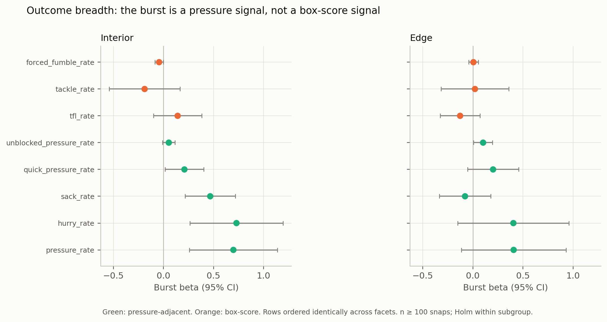
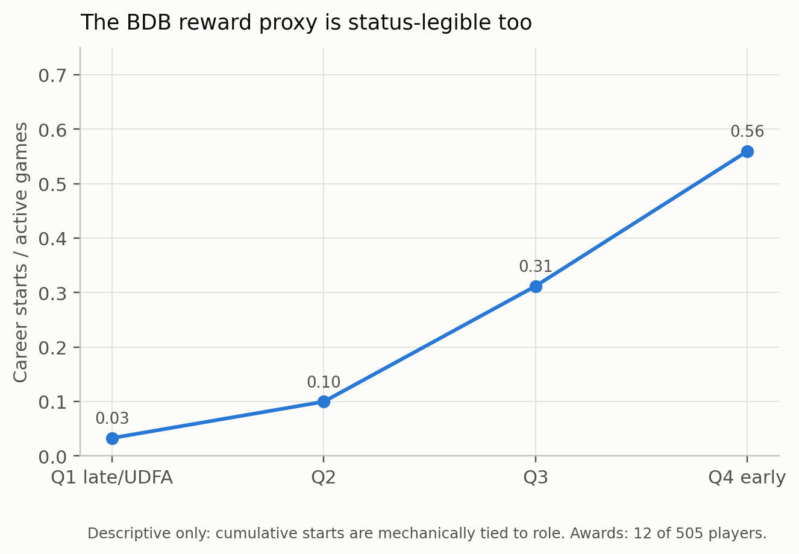

# Outcome breadth and the BDB-native reward ladder

## Part 1 — Is the burst a pressure signal or a general production signal?

### Method

- Per-player-season rates from `player_play`: pressure, sack, hurry, quick
  pressure, unblocked pressure, tackle-for-loss, tackle, forced fumble.
- Minimum 100 defensive snaps; 100 pass-rush snaps for sack rate. Rates are
  percentages.
- Split-half reliability by odd/even `play_id`; model
  `rate ~ burst_z + B_draft + C(season)`, player-clustered SE; Holm within
  subgroup.
- INTERIOR is the positive-control subgroup; EDGE is the weaker secondary.

### Results

| Subgroup | Outcome | Family | Players | Reliability | Beta (95% CI) | Status |
|---|---|---|---:|---:|---|---|
| INTERIOR | pressure | pressure-adjacent | 32 | 0.610 | **+0.698 (0.259, 1.137)** | supported |
| INTERIOR | hurry | pressure-adjacent | 32 | 0.631 | **+0.729 (0.265, 1.193)** | supported |
| INTERIOR | sack | pressure-adjacent | 25 | 0.493 | +0.467 (0.217, 0.717) | unidentifiable |
| INTERIOR | quick pressure | pressure-adjacent | 32 | 0.341 | +0.209 (0.017, 0.401) | unidentifiable |
| INTERIOR | unblocked pressure | pressure-adjacent | 32 | 0.045 | +0.053 (−0.008, 0.115) | unidentifiable |
| INTERIOR | tackle for loss | box-score | 32 | 0.468 | +0.142 (−0.099, 0.382) | unidentifiable |
| INTERIOR | tackle | box-score | 32 | −0.035 | −0.188 (−0.541, 0.164) | unidentifiable |
| INTERIOR | forced fumble | box-score | 32 | 0.109 | −0.043 (−0.085, −0.002) | unidentifiable |
| EDGE | pressure | pressure-adjacent | 43 | 0.425 | +0.407 (−0.115, 0.930) | unidentifiable |
| EDGE | hurry | pressure-adjacent | 43 | 0.446 | +0.404 (−0.151, 0.959) | unidentifiable |
| EDGE | sack | pressure-adjacent | 38 | 0.155 | −0.078 (−0.336, 0.179) | unidentifiable |
| EDGE | quick pressure | pressure-adjacent | 43 | 0.449 | +0.202 (−0.053, 0.457) | unidentifiable |
| EDGE | unblocked pressure | pressure-adjacent | 43 | −0.031 | +0.102 (0.008, 0.197) | unidentifiable |
| EDGE | tackle for loss | box-score | 43 | 0.160 | −0.128 (−0.327, 0.072) | unidentifiable |
| EDGE | tackle | box-score | 43 | 0.146 | +0.021 (−0.317, 0.359) | unidentifiable |
| EDGE | forced fumble | box-score | 43 | −0.051 | +0.006 (−0.042, 0.053) | unidentifiable |

### Reading

For interior linemen, the burst predicts pressure and hurries, the two
pressure-adjacent outcomes that clear the reliability gate. Sack rate has a
positive point estimate but misses the gate (0.493); quick pressure is
positive but too noisy (0.341). No box-score outcome clears the gate.

The honest formulation is asymmetric: **the burst is a pressure/hurry signal;
the box-score outcomes are not reliably measurable in this sample.** That is not
the same as proving the burst has no box-score effect. The point estimates are
not a consistent positive block, and the reliability failure means the null is
descriptive, not confirmatory.

EDGE shows positive pressure and hurry point estimates but every reliability is
below 0.50. The weaker EDGE signal is consistent with the entry's smaller EDGE
coefficient, but it is unidentifiable here.

## Part 2 — Is the BDB reward proxy status-legible?

### Method

- `player_career_successes.csv` via the panel: career starts / active games,
  career snaps / active game, and any All-Pro or Pro Bowl selection.
- All 505 position-group players; never-active players are kept as zero-career
  rows rather than dropped, so the ladder does not condition on surviving to a
  first game.
- OLS with HC1 robust SE, one row per player. Draft quartiles are rank-based
  because `B_draft` has a large tie at zero (undrafted).

### Results

| Model | Outcome | Term | Coefficient (95% CI) | n | R² |
|---|---|---|---:|---:|---:|
| draft only | start rate | B_draft | **+0.840 (0.768, 0.913)** | 505 | 0.511 |
| draft + performance | start rate | B_draft | +0.795 (0.708, 0.881) | 392 | 0.450 |
| draft + performance | start rate | mean performance | −0.017 (−0.047, 0.013) | 392 | 0.450 |
| draft + performance + role | start rate | B_draft | +0.282 (0.166, 0.398) | 160 | 0.792 |
| draft + performance + role | start rate | mean performance | −0.033 (−0.072, 0.006) | 160 | 0.792 |
| draft + performance + role | start rate | mean role | **+0.229 (0.199, 0.258)** | 160 | 0.792 |
| draft only | snaps / game | B_draft | **+53.7 (49.4, 58.0)** | 505 | 0.514 |
| draft + performance | snaps / game | mean performance | −0.269 (−2.138, 1.599) | 392 | 0.405 |
| draft + performance + role | snaps / game | mean role | **+12.3 (10.6, 14.0)** | 160 | 0.725 |

| Draft quartile | n | Start rate | Snaps / game | Awards |
|---|---:|---:|---:|---:|
| Q1 late/UDFA | 127 | 0.033 | 7.2 | 0 |
| Q2 | 126 | 0.100 | 13.9 | 0 |
| Q3 | 126 | 0.312 | 28.2 | 4 |
| Q4 early | 126 | 0.559 | 41.5 | 8 |

### Reading

The BDB-native reward proxy is descriptively status-legible; the relationship is mechanical. Career start rate rises
from 0.03 to 0.56 across draft quartiles; measured performance adds nothing once
draft is controlled (−0.017, p=0.27) and remains null with role added (−0.033,
p=0.10). Role itself is a strong correlate, as expected: career starts and snaps
accumulate through playing time.

This is the closest BDB analogue to the entry's cap/role wedge: the reward
measure tracks status and role, not measured performance. It is weaker evidence
than the cap result because career outcomes are cumulative and mechanically
related to role, and because the dataset has no pay. It is a reward-legibility
description, not a pricing model.

Awards are too rare for regression (12 of 505 players) and are concentrated in
the top two draft quartiles: 0, 0, 4, and 8 by quartile. Report the counts, not
a model.

