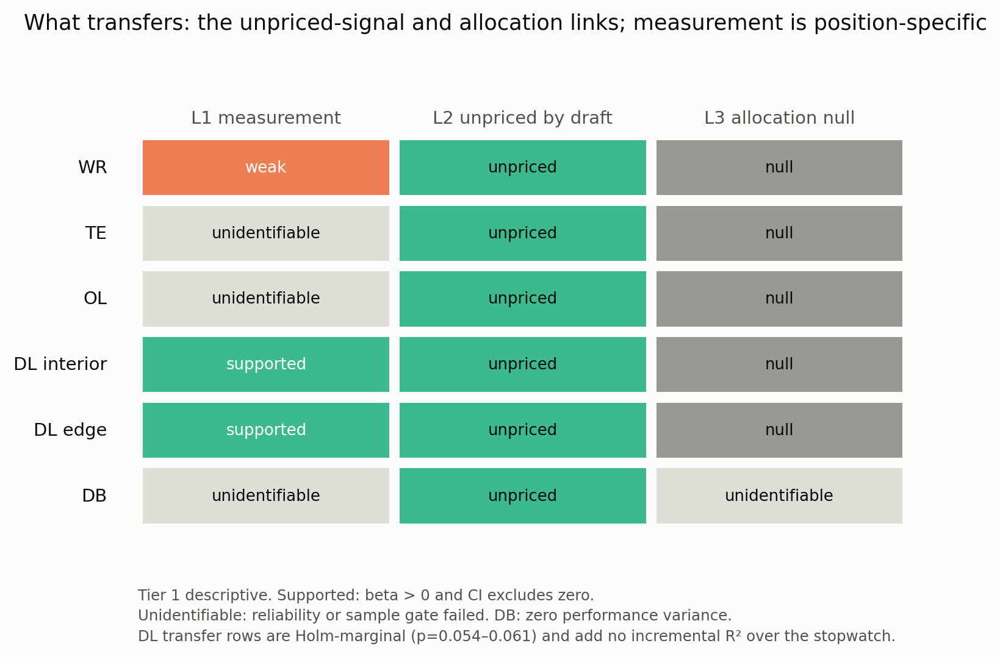

# What transfers, and what does not

## The short answer

The **structure** of the entry's argument travels. The **measurement** does not.

| Link | Transfers? | Evidence |
|---|---|---|
| L1 measurement | **Only for DL, and only conditionally** | Interior and edge pass-rush drills have positive pressure coefficients (+0.271 and +0.166); the entry benchmark reproduces (+0.368). The task-matched signal adds no out-of-sample R² over the stopwatch (−0.027, +0.015). WR is +0.053 with a CI spanning zero. TE, OL, DB fail reliability or variance gates. |
| L2 unpriced signal | **Yes, descriptively** | The drill signal is unpriced by draft in every position (\|ρ\| ≤ 0.10); the 40-yard dash is priced for WR (0.335) and DB (0.398), partly for OL (0.266). |
| L3 allocation | **Yes, robustly** | Performance→role is null in DL, WR, OL, TE; role and draft are positive. The gap runs from positive for late picks to negative for early picks in WR, OL, DL. |
| Burst outcome breadth | **Pressure only** | Interior pressure (+0.698) and hurry (+0.729) clear the gates; no box-score outcome clears reliability. |
| BDB reward proxy | **Status-legible** | Career start rate 0.03 → 0.56 across draft quartiles; performance adds nothing once draft is controlled. |

## What this means

1. **The portable claim is structural, not athletic.** The draft prices the
   incumbent stopwatch and not the task-matched drill signal; the depth chart
   rewards role and status, not measured performance; the BDB reward proxy
   rewards status. Those three statements hold across positions with enough
   data. That is the same "status-legible allocation, performance-legible
   pricing" reading as the entry.

2. **The Combine measurement is position-specific and fragile.** The DL result
   is real and reproduces. Outside DL, the only testable area is WR, and its
   signal is weak. TE and OL fail reliability gates; DB has no performance
   variance. This is consistent with the entry's own position-specific warning:
   the burst is not a universal talent score. A team should not assume the
   drill signal travels to another position just because the allocation pattern
   does.

3. **The allocation gap is descriptively consistent, not replicated.** The per-position gradient
   is visible in WR, OL, and DL, and the performance→role coefficient is null
   everywhere. The strict tail is small (4–6 players per position) and is a
   review list, not a population. That matches the entry's descriptive framing.

4. **The reward proxy is weaker evidence than the cap.** The BDB data have no
   pay. Career starts and snaps are cumulative and mechanically tied to role, so
   the career ladder is a reward-legibility description, not a pricing model.
   The cap result remains the stronger measured pricing leg in the judged entry.

## Tier 2 assumptions, descriptively

| Assumption | Prediction | Result |
|---|---|---|
| Risk-averse coach | Performance→role is flatter where outcome reliability is lower | **Not supported.** OL (reliability 0.553) has the only positive estimate; DL (0.953) is negative; TE (0.449) and WR (0.675) are null. |
| Cheap public status | Draft and prior role dominate wherever performance is measured | **Supported.** Role and draft are positive in every position; performance is null in every position. |
| Noisy, slow-updating performance | Concurrent performance is a stronger correlate than next-season role response | **Supported descriptively.** The next-season performance coefficient is null in every position; the concurrent estimate is also null or marginal. |
| Cap constraint | The reward is role; BDB has no pay | **Limitation.** Career starts are status-legible, but cumulative and mechanical. The cap result remains the stronger pricing evidence. |

The risk-aversion prediction is the one Tier 2 assumption this dataset does not
support. The status and noise predictions survive. That is a useful split: the
structural reading does not depend on the attenuation story.

## What would change the answer

- **Better outcomes for TE, OL, DB.** The gates fail on measurement, not on
  evidence of no effect. A more reliable separation, pressure-allowed, or
  coverage measure could make those areas testable.
- **A narrower WR signal.** The route-family composite is diluted. The per-drill
  exploratory estimates show positive CURL and POST_CORNER coefficients
  (+0.157 and +0.139) that do not survive FDR. A pre-registered, route-specific
  signal in a larger sample is the natural next test.
- **A direct pay measure.** This extension is BDB-native and Tier 1 only by
  design. If the pricing leg is wanted later, the existing OTC salary layer in
  `src/salary/` can extend the cap model by position. That is outside this
  protocol.
- **A Tier 2 model.** Not estimated here by design. The assumptions are stated
  as predictions only; no coach/GM wedge or dollar value is claimed in the new
  areas.

## Practical reading

If the principle is to be reused outside interior defensive line, the
defensible order is:

1. Start with the allocation and pricing side: review role-versus-performance
   gaps, and price the next contract on role-controlled performance. Those
   patterns travel.
2. Treat the Combine drill signal as position-specific. Re-run the reliability
   and out-of-sample checks before using it in a new room.
3. Do not claim a dollar value in a new area from this extension. The
   implications valuation was built on the interior-DL measurement and the cap;
   neither condition is reproduced here.

## Tier labels

- Everything in this folder is **Tier 1 descriptive**. The L1 supported rows are
  associations, not validated tools. The L2 and L3 rows are descriptive
  patterns. The career ladder is a reward-legibility description.
- No causal claim about coaches, teams, schemes, injuries, or contracts.
- No dollar model, no two-agent model, no external salary data.
