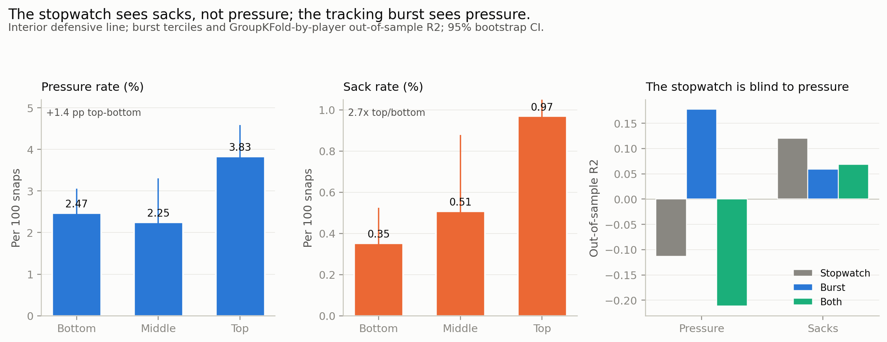
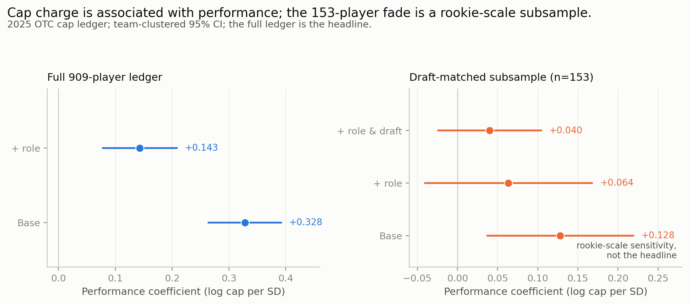
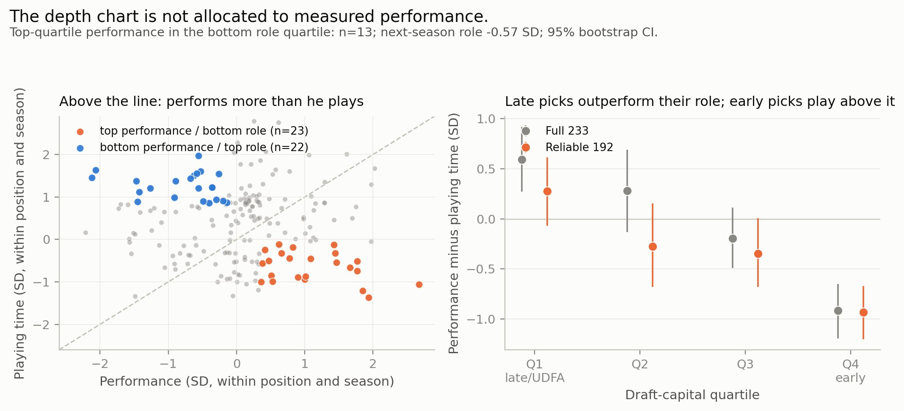
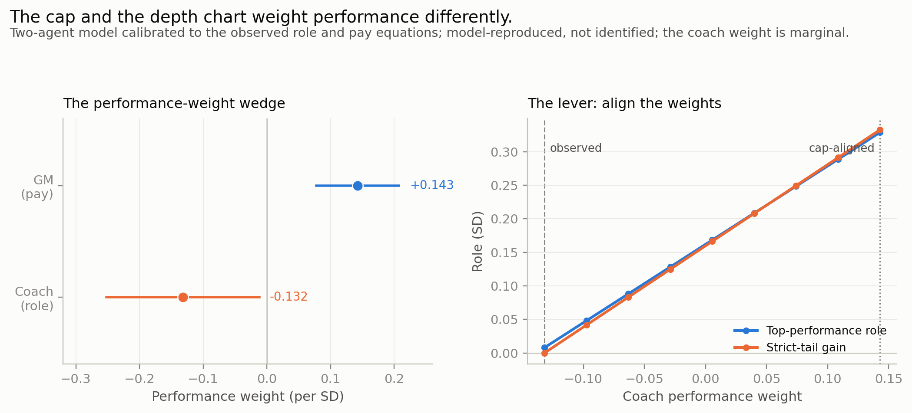

# The Combine's pressure signal is real; the allocation gap is the lever

## Part 1 — What the data show, and what they imply

The data support a narrow finding: a 10 Hz Combine burst predicts interior pressure and sacks, while the stopwatch does not carry the pressure signal. Under normal assumptions about role allocation, that signal implies a larger gap. The argument is tiered; each tier says what it can support.

We studied the 2023–2025 draft classes: 543 player-seasons with movement and performance, 233 with a next season, and 909 players in the 2025 cap ledger.

### Tier 0 — What the data alone show

**The pressure signal.** For interior defensive linemen, average the Combine z-scores for max speed and first-step acceleration. The top tercile generates 3.83% pressure per defensive snap, the bottom 2.47% (+1.4 points); sacks run 0.97% versus 0.35% per pass rush (2.7×). The middle is flat (2.25%), so the signal is a top-versus-bottom contrast, not a gradient. The burst predicts pressure at +0.354 SD per SD (95% CI 0.143 to 0.565, n=64) and sacks at +0.317 (0.083 to 0.550, n=63), controlling draft and season. Edge rushers show a smaller pressure signal (+0.157) and no sack signal (+0.035).

**The stopwatch is blind to pressure.** In the timed interior sample, the 40-yard dash and 10-yard split jointly explain pressure with p=0.998; the burst adds +0.049 R². Out of sample, by player, the stopwatch scores −0.113 for pressure and the burst +0.178. For sacks the stopwatch is positive (+0.120) and the burst adds only +0.007 R². The pure claim: the 10 Hz burst is a position-specific production signal; the stopwatch does not carry the pressure signal. Figure 1.

**The Combine signal is position-specific.** The movement composite predicts defensive-line performance (+0.734 raw; +0.42 SD per SD, 0.26 to 0.58, n=175), but not offensive line (+0.058) or tight end (+0.093); receiver is marginal (+0.366, p=0.084); interaction p=0.0004. The pooled +0.299 is a defensive-line result. The defensive-line outcome is get-off, so part is a validity check. Figure 2.

**The cap pays for performance.** On the full 909-player 2025 ledger, a standard deviation of measured performance is associated with +0.328 log points of cap charge (95% CI 0.264 to 0.392), controlling age, experience, and position. Adding playing time gives +0.143 (0.078 to 0.208). The salary measure is nflverse production, partly role-loaded (r≈0.5 with snaps), not the NGS residual. Figure 3.

**The depth chart does not detectably reward performance.** Current playing time (+0.606) and draft capital (+0.785) predict next-season playing time; the performance coefficient is −0.011 (95% CI −0.119 to 0.097, n=233). The concurrent estimate is −0.132 (p=0.031), marginal; a shuffle gives −0.10. The within-player estimate is −0.095 (p=0.11, n=235). This is absence of evidence, not proof of zero. Figure 4.

### Tier 1 — What the pattern implies

The cap pays for performance; the depth chart does not. The allocation problem is in playing time, not the cap. The performance-role gap by draft is +0.59 for late picks and undrafted players and −0.92 for early picks in the full 233-row sample (+0.28 and −0.93 in the reliable 192). The gap is about nine parts role to one part performance; the strict top/bottom quartile tail is 13 player-seasons (12 players), a review list. Figure 5.

### Tier 2 — What reasonable assumptions add

Assume what is normal in a football building: coaches are risk-averse; draft status and prior role are cheap public signals; performance is noisy; the cap is a constraint. Under those assumptions, the depth chart rewards predictable status; the cap prices performance; the gap is the cost of the risk and status weights.

A two-agent model calibrates the coach's role rule and the GM's pay rule to the observed equations. The coach weights performance at −0.13 (marginal; a within-position/season shuffle gives −0.10, p=0.10); the GM at +0.14. The wedge is +0.28. Aligning the coach's performance weight with the GM's raises the top-performance group's role by 0.32 SD and the strict tail's role by 0.33 SD in the model. Model-reproduced, not identified. Figure 6.

### Tier 3 — What the perspectives add

- **Coach:** review the largest performance-role gaps; a monthly review is a process choice, not a tested rule.
- **GM:** the cap is not the problem; use the position-specific Combine for DL get-off.
- **League office:** the gap is structural; the rookie scale and role pipeline are the levers.
- **Youth:** late picks performing above role are the development target.
- **RJF:** the risk-transfer interpretation is the perspective; the preregistered test is a wide null, not confirmation.

### What this does not say

The pure data do not identify a universal performance effect or a causal coaching effect. The model is a consistency check; the assumptions are contestable. The cap and Combine use different measures. The OL/TE nulls may be attenuation: reliability 0.55 (OL) and 0.45 (TE) versus 0.95 (DL). The n=13 tail is a review list.

**Table 1. Football scorecard.**

| Criterion | Evidence tier | Evidence | Operational use | Caveat |
|---|---|---|---|---|
| Week-to-week usability | Data + principle | Snaps persist; performance adds no detectable next-week or next-season signal. | Review the largest performance-role gaps; no tested cadence. | Absence of evidence; snaps are not depth-chart rank. |
| Complexity | Data | Position-specific Combine; 543 performance rows; 233/192 role rows; 909 cap rows. | One analyst can maintain it; output is a short review list. | Performance measures differ by position; DB excluded; cap uses nflverse production. |
| Uniqueness | Data + assumptions | The cap pays for performance; the depth chart rewards status and prior role. | Ask whether the depth chart uses the signal the testing shows. | A pattern, not a causal claim. Cap spending is an estimate, not intent. |

## Part 2 — Method and evidence

### Data

The 2023–2025 Combine cohorts: 510 players; 401 with 722 regular-season player-seasons. Combine tracking: 10 Hz. Performance comes from Next Gen Stats `player_play`; snaps and games from the tracking panel, with nflverse snap counts used in the salary layer. Salary data combine OverTheCap positional spending (96 team-seasons), archived 2025 OTC active-cap pages (32 teams; 99.3% of active-cap dollars match a 2025 snap), and a contract snapshot.

The performance sample is 543 player-seasons: 722 minus 165 defensive backs and 14 without a performance measure. The role sample is 233 with a next season, 192 with at least 50 performance plays. The cap sample is 909 players, 68.7% of active-cap dollars; offensive linemen and specialists are excluded. The cap model uses nflverse production; the Combine and role models use the NGS residual. The drill-translation sample is 64 interior player-seasons, 56 with traditional timing.

### Measures

**Combine movement.** Attempt-level z-scores within drill and position for max speed, first-step acceleration, time to 1 yard (reversed), and path efficiency, averaged per player and re-standardized. The interior burst is the average of the standardized speed and acceleration components; the stopwatch is the 40 and 10-yard split, faster is better.

**Performance.** Position-specific play outcome, higher-is-better: defensive-line get-off, receiver/tight-end separation, offensive-line pressure allowed, defensive-back pass result. Residualized against play context (down, distance, pressure, coverage, field position, motion, blitz, season) with ridge and 5-fold grouped cross-validation; empirical-Bayes shrunk and standardized.

**Production.** Pressure is the share of defensive snaps with a recorded pressure; sacks are the share of pass-rush snaps with a sack. Both are measured from `player_play`; the interior burst models use these rates as outcomes.

**Playing time.** Snaps per appearance, standardized within position and season. The role residual is from playing time regressed on performance, draft capital, prestige, position, and season; positive means more snaps than comparable players.

**Cap model.** For 2025, log cap number is modeled on performance, age, experience, and position on the full 909-player ledger; adding playing time gives the role-controlled model. The 153-player draft-matched model adds `B_draft` as a rookie-scale sensitivity. The salary performance is nflverse public production, not the NGS residual.

**Draft capital.** `B_draft` is a within-position, within-class percentile; early and late picks are its quartiles.

**Allocation gap.** Performance z minus playing-time z, both within position group and season. Positive means the player performs above his role; it is not the role residual.

### Models

OLS with player-clustered standard errors; salary models cluster by team with season controls. The Combine models are position-specific; the role models use current role, performance, draft capital, position, and season; the cap model is on the full 909-player ledger. The agent model calibrates the coach role equation and the GM pay equation and simulates the performance-weight lever; it is a consistency check, not an identification.

**Table 2. Selected models (coefficient, 95% CI, n).**

| Model | Term | Coefficient (95% CI) | n |
|---|---|---|---|
| Interior burst → pressure | Burst | +0.354 (0.143, 0.565) | 64 |
| Interior burst → sacks | Burst | +0.317 (0.083, 0.550) | 63 |
| Combine → performance, DL | Combine movement | +0.734 (0.461, 1.007) | 175 |
| Combine → performance, WR | Combine movement | +0.366 (−0.049, 0.781) | 149 |
| Combine → performance, OL | Combine movement | +0.058 (−0.114, 0.230) | 156 |
| Combine → performance, TE | Combine movement | +0.093 (−0.221, 0.407) | 63 |
| Next-season playing time | Current playing time | +0.606 (0.510, 0.701) | 233 |
| Next-season playing time | Performance | −0.011 (−0.119, 0.097) | 233 |
| Next-season playing time | Draft capital | +0.785 (0.347, 1.222) | 233 |
| Cap model, full ledger | Performance, base | +0.328 (0.264, 0.392) | 909 |
| Cap model, full ledger | Performance, + role | +0.143 (0.078, 0.208) | 908 |
| Agent model | Coach performance weight | −0.132 (−0.252, −0.012) | 233 |
| Agent model | GM performance weight | +0.143 (0.078, 0.208) | 908 |

### Validation and robustness

The next-season model has out-of-sample R² 0.503; the performance coefficient stays between −0.038 and +0.026 across folds. The Combine coefficient is a cross-player association, not a season forecast. The position-specific estimates are exploratory; the interaction test is the stronger evidence. The pressure model is cross-player; the sack model is the temporally more stable half. The cap residual is an accounting residual; the role null is an absence-of-evidence result; the allocation gap is descriptive and the strict tail recovers +0.25 SD. The predictability lens does not survive role controls. The notebook's reconstruction gives +0.295/−0.034 (n=195) and DL +0.726/TE +0.076; the pipeline gives +0.299/−0.019 (n=192) and +0.734/+0.093; the differences are reconstruction scale and role universe.

### Limits

Observational; no causal claims. Playing time is snaps per appearance, not depth-chart rank or intent. Defensive-back performance is unidentifiable and excluded. Salary is a proxy: cap hits reflect proration, restructures, and timing; the cap residual is descriptive; the 153-player model is a rookie-scale sensitivity. The weekly check is exploratory. Opponent, injuries, scheme, and game script are unavailable.

The preregistered transition-zone (RJF/Yellow Square) analysis in the appendix returned a wide null: Yellow +0.176 (p=0.077, n=30); 2024–25 +0.144 (p=0.18, n=23); null Möbius/pond increments; negative out-of-time R². The CIs rule out only large effects; we treat it as fallback evidence, not confirmation.

### Code

Public notebook: https://www.kaggle.com/code/patrickm/nfl-bdb-2027-the-allocation-gap

Code: [Combine movement](https://github.com/PatrickMockridge/nfl-big-data-bowl-2027/blob/main/src/features/combine_movement.py), [performance](https://github.com/PatrickMockridge/nfl-big-data-bowl-2027/blob/main/src/features/performance.py), [cost-risk](https://github.com/PatrickMockridge/nfl-big-data-bowl-2027/blob/main/src/discovery/cost_risk.py), [agent model](https://github.com/PatrickMockridge/nfl-big-data-bowl-2027/blob/main/src/framework/agentic_allocation.py).
