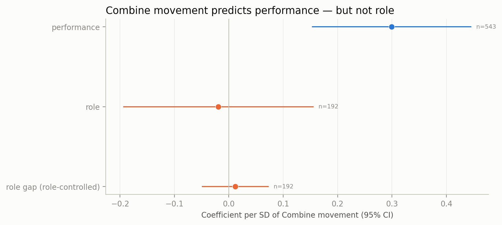
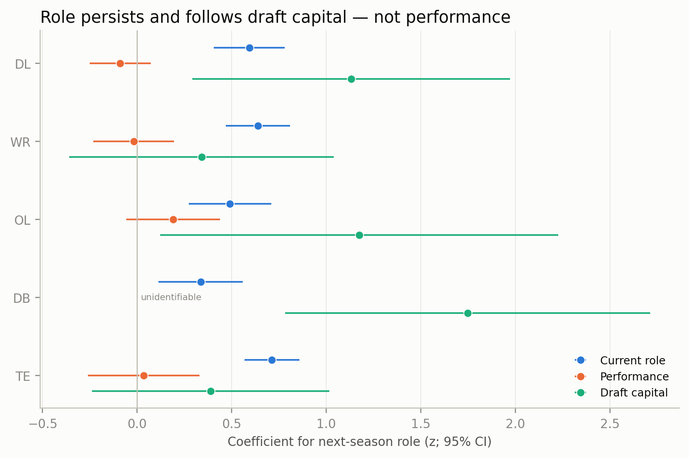
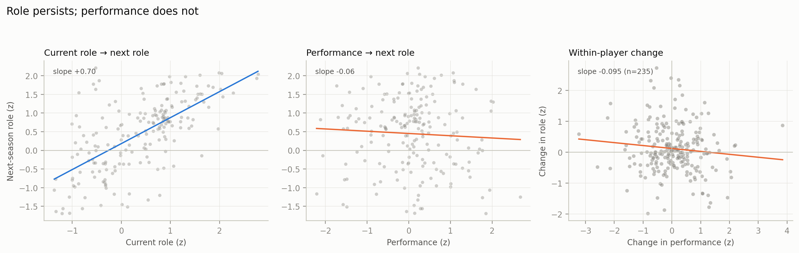
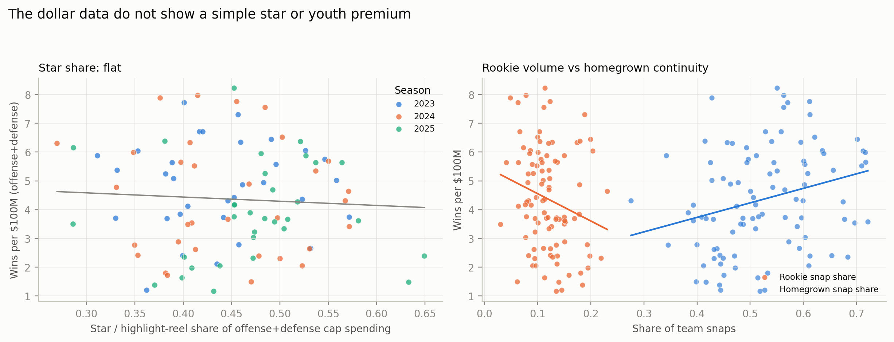
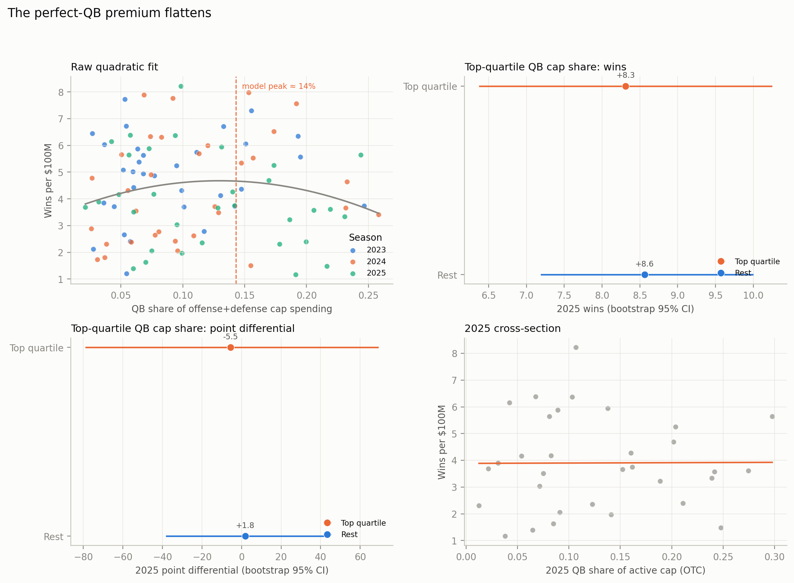

# The Allocation Gap: The Combine Signal Is Real; the Depth Chart and the Cap Ignore It

**NFL Big Data Bowl 2027 — a multi-lens audit of 510 rookies**

## What is new

The 10 Hz Combine movement signal is real: it predicts context-adjusted regular-season performance at **+0.299 SD per SD** (n = 543). But the depth chart does not use it. The same composite does not predict role (**−0.019**, p = 0.83), and next-season role follows current role (**+0.606**) and draft capital (**+0.785**), not performance (**−0.011**). When the same player’s performance changes, role does not follow (**−0.095**, p = 0.11). The cap repeats the pattern: star/highlight-reel share is unrelated to wins per dollar (**−0.70**, p = 0.89), rookie snap share is negative (**−28.4**, p = 0.004), homegrown snap share is positive (**+9.2**, p = 0.001), and QB spending flattens at about **14% of payroll**. The binding constraint is not measurement; it is allocation. The public conversation stops at prediction; this entry tests the next link.

## The question

The competition asks whether Combine movement translates to regular-season performance. We ask the next question: once the signal is measured, does the organization act on it — in the depth chart and in the cap? The starting point was the Romeo–Juliet framework’s Yellow Square, a transition zone where failure was expected to concentrate. In a corrected regular-season panel, the Yellow signal was a wide null. That null moved the search from the measurement layer to the allocation layer.

## The signal is real

The generic Combine movement composite — first-step acceleration, path efficiency, top speed, time to one yard — predicts context-adjusted regular-season performance: **+0.299 SD per SD** (95% CI 0.153 to 0.446, p < 0.001, n = 543). The sensor signal is not noise. The original Yellow Square lens was a wide null; the movement composite is the positive Combine-to-performance result the competition asks for.

*Figure 1. Combine movement predicts performance; it does not predict role or the role gap.*

## The depth chart doesn’t use it

The same composite does not predict role: **−0.019** (95% CI −0.194 to 0.156, p = 0.83, n = 192). It does not predict the role gap: +0.012 (−0.049 to 0.073, p = 0.70). The sensor signal stops at the depth chart.

Next-season role is explained by current role and draft capital, not performance. Current role **+0.606** (0.510 to 0.701), draft capital **+0.785** (0.347 to 1.222), performance **−0.011** (−0.119 to 0.097, p = 0.84). A performance-only model agrees: performance −0.096 (−0.226 to 0.034, p = 0.15), draft +1.454 (0.727 to 2.181). The null survives a team-mean-role control (−0.016), pass-play role (−0.078), and cohort role share (−0.060). Leave-one-player-out R² is **0.503**, and the performance coefficient stays between −0.038 and +0.026 across folds. The within-player test is the identification move: when the same player’s performance changes, role does not follow (**−0.095**, 95% CI −0.211 to 0.022, p = 0.11, n = 235).

*Figure 2. Next-season role by position. Current role and draft capital predict it; performance does not. DB performance is unidentifiable.*

*Figure 3. Current role predicts next role; performance does not, within or between players.*

## The cap repeats the pattern

If the allocation layer ignores measured performance, the cap should show a similar pattern. It does. Across 96 team-seasons, the star/highlight-reel share of offense-plus-defense cap spending is unrelated to wins per $100M: **−0.70** (95% CI −10.23 to +8.83, p = 0.89), or −0.05 wins per SD. The null holds for point differential, offensive EPA per dollar, and the 2025 OTC active-cap measure.

The variables that move are age and continuity. Rookie snap share is negatively associated with wins: **−28.4** (95% CI −48.0 to −8.8, p = 0.004), or −2.8 wins per 10 percentage points. Homegrown snap share — snaps by players drafted by the team — is positively associated: **+9.2** (3.8 to 14.6, p = 0.001), or +0.9 wins per 10 points. The pattern holds for point differential (rookie −978, homegrown +363) and offensive EPA per play (rookie −0.60, homegrown +0.40). Adding star and youth shares leaves star at zero (−1.3, p = 0.77); homegrown remains +10.2 (p = 0.001). This is a correlation: bad teams play rookies, and good teams retain their own. But “play the kids” is not a free lunch, and “buy stars” is not a premium that pays.

The quarterback market is the clearest case of diminishing returns. A quadratic model with payroll and season controls peaks at a QB share of about **14% of offense-plus-defense spending** (linear +42.4, quadratic −149.2, p ≈ 0.07). The 2025 top quartile of QB cap share does not win more: 8.31 wins versus 8.56 for the rest; point differential −5.5 versus +1.8. The estimate is suggestive, not decisive.

The rent proxy is the second layer. A pay model — log 2025 cap number on performance z, age, experience, and position — explains 44% of the variance. The residual is a cap-allocation residual, not a causal rent. Teams in the bottom efficiency quartile carry **$51M** of positive star-plus-underperformer residual per team; the top quartile carries **$31M**; Q4−Q1 is **−$20.5M** (bootstrap 95% CI −$40.9M to −$2.0M). Underperformer rent alone is −$6.3M (−$14.5M to −$0.2M); youth surplus is +$1.9M (+$0.1M to +$4.0M). Correlations with wins per $100M: −0.34 for underperformer rent, +0.35 for youth surplus; star rent is −0.31 but its CI crosses zero. A cash-pay sensitivity reproduces the signs.

*Figure 4. Star share is unrelated to wins per $100M. Rookie-heavy teams win less; homegrown-heavy teams win more.*

*Figure 5. QB spending has diminishing returns; the top quartile of QB cap share does not win more.*

## Football score: can a team use this?

**Would a team use it week to week?** The season-level result is robust, but it is not a single-week trigger. A weekly check tells the operational story: next-week role is predicted by this-week role (**+0.753**, 95% CI 0.717 to 0.788), not by this-week performance (**−0.006**, −0.027 to 0.015, p = 0.59; 3,885 player-weeks, 249 players). Early-season performance also does not predict late-season role after controlling for early role (**+0.008**, −0.072 to 0.087, p = 0.85; 282 player-seasons, 180 players). A team should therefore run a rolling role review after weeks 4–6 and then every 2–3 weeks, not after every game. Inputs: snaps per game, the position-specific performance residual, draft/role expectation, and the role gap. Outputs: two flags — low role/high performance (review for more snaps) and high role/low performance (justify or reduce). The flag triggers a coach/scout review of depth-chart and snap allocation; it does not automate playing time. For the league office, the same flags aggregate into an allocation audit, not individual discipline.

**Does the analysis account for football’s complexity?** The models control position group, season, draft capital, current role, team role environment, pass-play role and cohort role share as sensitivities, within-player changes, and play context in the performance residual (down, distance, coverage, pressure). The salary models add payroll and season. They do not control opponent quality, injuries or availability beyond games played, coaching/scheme changes, game script, contract timing, or unobserved health. Those omissions are why the flag is a review trigger, not a verdict.

**Are the ideas unique?** Public notebooks often test whether Combine metrics correlate with performance. This entry tests whether the organization acts on the signal. The unique contribution is the **translation-to-allocation audit**: Combine → performance → role → cap. The within-player test is the identification move; the cap is an independent second test of the same gap. The RJF reversal is the method: the Yellow and Möbius lenses were nulls, so the analysis searched for where the system is not self-regulating and found the allocation layer. The signal is real; the allocation decision is where it is lost.

## Limits

This is observational; we make no causal claims about coaches, teams, schemes, injuries, or contracts. Role is snaps per appearance, not a full depth-chart share; pass-play role and cohort role share are sensitivities. The panel covers 401 of 510 players and 233 role-model player-seasons; quarterbacks, running backs, linebackers, and special-teamers are excluded from the role models. The dollar panel is 96 team-seasons; OTC positional spending is not a full cap ledger; the 2025 active-cap snapshot covers 99% of active-cap dollars, but the rent sample covers 69% because offensive linemen and specialists are excluded. The weekly check is exploratory and covers DL/WR/TE/OL; DB and LB samples are too thin. A five-club soccer comparison is in the repository appendix; it is illustrative, not an NFL test.

## Table 1. Selected models

| Model | Term | Coefficient (95% CI) | n |
|:--|:--|:--|--:|
| Combine movement → performance | Movement | +0.299*** (+0.153, +0.446) | 543 |
| Combine movement → role | Movement | −0.019 (−0.194, +0.156) | 192 |
| Next role | Current role | +0.606*** (+0.510, +0.701) | 233 |
| Next role | Performance | −0.011 (−0.119, +0.097) | 233 |
| Next role | Draft capital | +0.785*** (+0.347, +1.222) | 233 |
| Within-player Δrole | ΔPerformance | −0.095 (−0.211, +0.022) | 235 |
| Wins per $100M | Star share | −0.70 (−10.23, +8.83) | 96 |
| Wins per $100M | Rookie snap share | −28.39** (−47.96, −8.82) | 96 |
| Wins per $100M | Homegrown snap share | +9.21*** (+3.81, +14.62) | 96 |
| Next-week role | Current-week role | +0.753*** (+0.717, +0.788) | 3,885 |
| Next-week role | Current-week performance | −0.006 (−0.027, +0.015) | 3,885 |

\* p < 0.05, \*\* p < 0.01, \*\*\* p < 0.001. Core models cluster by player; salary models cluster by team and include season fixed effects plus log payroll; weekly models cluster by player and include position, draft, week, and season controls.

## Table 2. Rent decomposition by efficiency quartile (2025, $M per team)

| Efficiency quartile | Teams | Star rent | Underperformer rent | Youth surplus | Wins per $100M |
|:--|--:|--:|--:|--:|--:|
| Q1 low | 8 | 43.9 | 7.3 | 0.8 | 1.80 |
| Q2 | 8 | 67.2 | 2.2 | 0.5 | 3.29 |
| Q3 | 8 | 56.0 | 1.7 | 2.2 | 4.24 |
| Q4 high | 8 | 29.7 | 1.0 | 2.7 | 6.28 |

Rent = positive residual from log 2025 cap number on performance z, age, experience, and position; a cap-allocation residual, not a causal rent. Sample: 909 players, 69% of active cap dollars; OL/specialists excluded.

## Table 3. Football scorecard

| Criterion | Evidence | Operational use | Caveat |
|:--|:--|:--|:--|
| Week-to-week | Next-week role follows this-week role (+0.753); performance −0.006 (p = 0.59); early performance does not predict late role (+0.008, p = 0.85) | 4–6 week rolling role review; two flags: low role/high performance, high role/low performance | Season-level evidence; weekly sample 3,885 player-weeks |
| Complexity | Controls: position, season, draft, current role, team role environment, play context, within-player. Not: opponent, injuries, scheme/coaching, game script, contract timing | Review trigger, not an automated verdict | Public data cannot observe coaching intent or health |
| Uniqueness | Translation-to-allocation audit: Combine → performance → role → cap; within-player test; cap replication; RJF nulls → allocation layer | New link and test, not another Combine metric | Observational; no causal claim |

*Code, diagnostics, the core pipeline, and the formal appendix are in the public Kaggle notebook; the broader lens scan and source notes are in the repository. The notebook is a compact reproduction of the core pipeline; coefficients can differ with complete-case and feature-standardization choices.*
